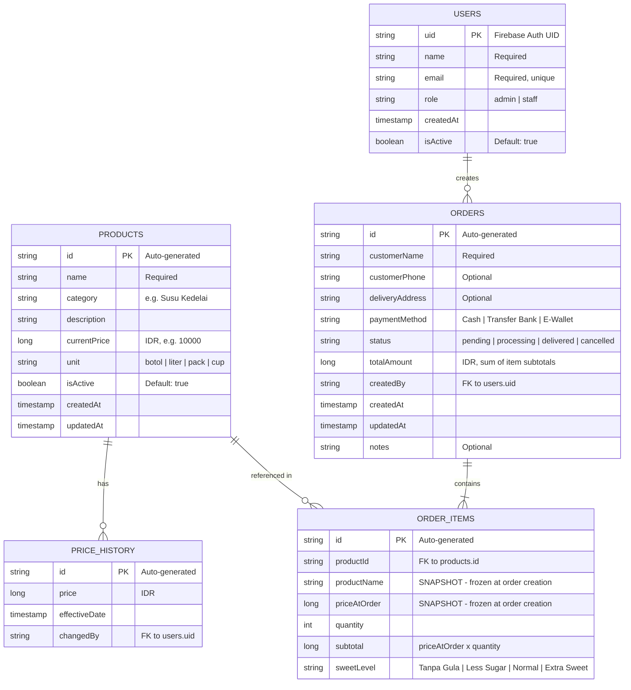
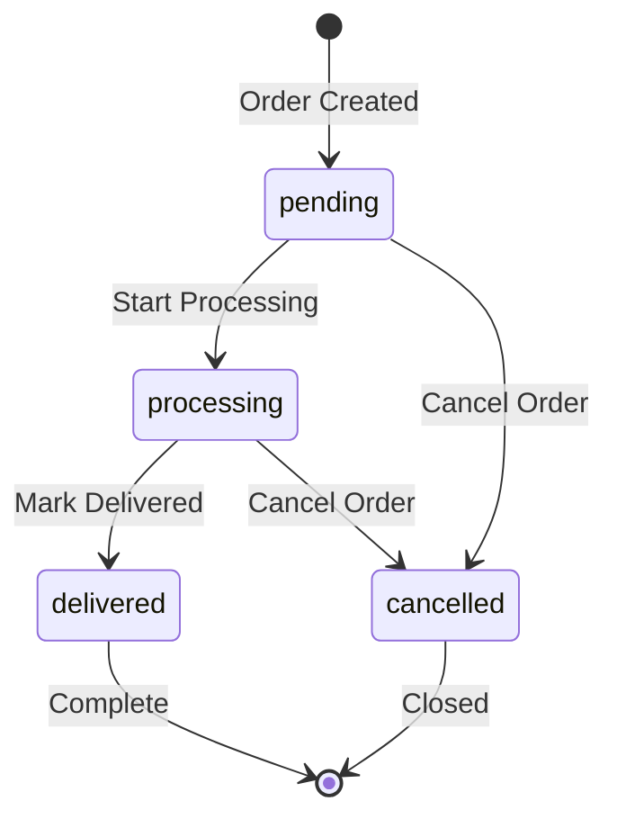

# Database Schema — JoyMilk (Cloud Firestore)

## 1. Overview

| Property | Value |
|---|---|
| **Database** | Cloud Firestore (NoSQL document database) |
| **Project** | JoyMilk — Internal soy milk order management |
| **Structure** | Collections → Documents → Subcollections |
| **Timestamps** | Firestore `Timestamp` type (UTC) |
| **Currency** | All money values stored as `Long` (IDR, no decimals) |
| **Auth Provider** | Firebase Authentication (Email/Password) |

> [!IMPORTANT]
> All monetary values are stored as `Long` in Indonesian Rupiah **without decimals**.
> Example: **Rp 10.000** is stored as `10000`.

### Collection Map

```
Firestore Root
├── users/{userId}
├── products/{productId}
│   └── priceHistory/{historyId}       ← subcollection
└── orders/{orderId}
    └── items/{itemId}                 ← subcollection
```

---

## 2. Entity-Relationship Diagram



---

## 3. Collection Details

### 3.1 `users`

| | |
|---|---|
| **Path** | `/users/{userId}` |
| **Primary Key** | `uid` (same as Firebase Auth UID) |
| **Description** | Internal users — admins and staff |

| Field | Type | Required | Description |
|---|---|---|---|
| `uid` | `string` | ✅ | Primary key, matches Firebase Auth UID |
| `name` | `string` | ✅ | Display name |
| `email` | `string` | ✅ | Email address (unique) |
| `role` | `string` | ✅ | `"admin"` or `"staff"` |
| `createdAt` | `timestamp` | ✅ | Account creation time |
| `isActive` | `boolean` | ✅ | Whether user can log in (default: `true`) |

**Example Document:**

```json
// /users/abc123def456
{
  "uid": "abc123def456",
  "name": "Budi Santoso",
  "email": "budi@joymilk.id",
  "role": "admin",
  "createdAt": "2026-01-15T08:00:00Z",
  "isActive": true
}
```

---

### 3.2 `products`

| | |
|---|---|
| **Path** | `/products/{productId}` |
| **Primary Key** | `id` (auto-generated by Firestore) |
| **Description** | Product catalog with current pricing |

| Field | Type | Required | Description |
|---|---|---|---|
| `id` | `string` | ✅ | Auto-generated document ID |
| `name` | `string` | ✅ | Product name |
| `category` | `string` | ✅ | Category grouping |
| `description` | `string` | ❌ | Product description |
| `currentPrice` | `long` | ✅ | Current price in IDR |
| `unit` | `string` | ✅ | Unit of measure |
| `isActive` | `boolean` | ✅ | Whether product is available (default: `true`) |
| `createdAt` | `timestamp` | ✅ | Creation timestamp |
| `updatedAt` | `timestamp` | ✅ | Last update timestamp |

**Valid values for `category`:**

| Category | Description |
|---|---|
| `"Susu Kedelai"` | Plain soy milk |
| `"Susu Kedelai Rasa"` | Flavored soy milk |
| `"Topping"` | Add-on toppings |

**Valid values for `unit`:**

| Unit | Description |
|---|---|
| `"botol"` | Bottle |
| `"liter"` | Liter |
| `"pack"` | Pack |
| `"cup"` | Cup |

**Example Document:**

```json
// /products/prod_001
{
  "id": "prod_001",
  "name": "Susu Kedelai Original",
  "category": "Susu Kedelai",
  "description": "Susu kedelai murni tanpa tambahan perasa",
  "currentPrice": 10000,
  "unit": "botol",
  "isActive": true,
  "createdAt": "2026-01-15T08:00:00Z",
  "updatedAt": "2026-03-20T10:30:00Z"
}
```

---

### 3.3 `priceHistory` (subcollection of `products`)

| | |
|---|---|
| **Path** | `/products/{productId}/priceHistory/{historyId}` |
| **Primary Key** | `id` (auto-generated by Firestore) |
| **Description** | Price change audit trail |

| Field | Type | Required | Description |
|---|---|---|---|
| `id` | `string` | ✅ | Auto-generated document ID |
| `price` | `long` | ✅ | The new price in IDR |
| `effectiveDate` | `timestamp` | ✅ | When the price change took effect |
| `changedBy` | `string` | ✅ | `userId` of the admin who changed the price |

> [!NOTE]
> A `priceHistory` entry is **auto-created** whenever an admin updates a product's `currentPrice`.
> The entry records the **new** price that was set.

**Example Document:**

```json
// /products/prod_001/priceHistory/ph_001
{
  "id": "ph_001",
  "price": 12000,
  "effectiveDate": "2026-03-20T10:30:00Z",
  "changedBy": "abc123def456"
}
```

---

### 3.4 `orders`

| | |
|---|---|
| **Path** | `/orders/{orderId}` |
| **Primary Key** | `id` (auto-generated by Firestore) |
| **Description** | Customer orders placed by staff or admin |

| Field | Type | Required | Description |
|---|---|---|---|
| `id` | `string` | ✅ | Auto-generated document ID |
| `customerName` | `string` | ✅ | Customer's name |
| `customerPhone` | `string` | ❌ | Customer's phone number |
| `deliveryAddress` | `string` | ❌ | Delivery address |
| `paymentMethod` | `string` | ✅ | Payment method used |
| `status` | `string` | ✅ | Current order status |
| `totalAmount` | `long` | ✅ | Total in IDR (sum of item subtotals) |
| `createdBy` | `string` | ✅ | `userId` of who created the order |
| `createdAt` | `timestamp` | ✅ | Order creation timestamp |
| `updatedAt` | `timestamp` | ✅ | Last update timestamp |
| `notes` | `string` | ❌ | Additional notes |

**Valid values for `paymentMethod`:**

| Payment Method | Description |
|---|---|
| `"Cash"` | Cash payment |
| `"Transfer Bank"` | Bank transfer |
| `"E-Wallet"` | E-Wallet (GoPay, OVO, DANA, etc.) |

**Valid values for `status`:**

| Status | Description |
|---|---|
| `"pending"` | Order received, awaiting processing |
| `"processing"` | Order being prepared |
| `"delivered"` | Order delivered to customer |
| `"cancelled"` | Order cancelled |

**Example Document:**

```json
// /orders/ord_20261110_001
{
  "id": "ord_20261110_001",
  "customerName": "Ibu Sari",
  "customerPhone": "081234567890",
  "deliveryAddress": "Jl. Merdeka No. 45, Bandung",
  "paymentMethod": "Transfer Bank",
  "status": "pending",
  "totalAmount": 56000,
  "createdBy": "staff_user_789",
  "createdAt": "2026-11-10T09:15:00Z",
  "updatedAt": "2026-11-10T09:15:00Z",
  "notes": "Antar sebelum jam 12 siang"
}
```

---

### 3.5 `items` (subcollection of `orders`)

| | |
|---|---|
| **Path** | `/orders/{orderId}/items/{itemId}` |
| **Primary Key** | `id` (auto-generated by Firestore) |
| **Description** | Individual line items within an order |

| Field | Type | Required | Description |
|---|---|---|---|
| `id` | `string` | ✅ | Auto-generated document ID |
| `productId` | `string` | ✅ | Reference to `products.id` |
| `productName` | `string` | ✅ | **SNAPSHOT** — product name at order time |
| `priceAtOrder` | `long` | ✅ | **SNAPSHOT** — price in IDR at order time |
| `quantity` | `int` | ✅ | Number of units ordered |
| `subtotal` | `long` | ✅ | `priceAtOrder × quantity` |
| `sweetLevel` | `string` | ✅ | Sweetness preference |

**Valid values for `sweetLevel`:**

| Sweet Level | Description |
|---|---|
| `"Tanpa Gula"` | No sugar |
| `"Less Sugar"` | Less sugar |
| `"Normal"` | Normal sweetness |
| `"Extra Sweet"` | Extra sweet |

> [!CAUTION]
> `productName` and `priceAtOrder` are **price snapshots**. They are frozen at order creation
> and **MUST NOT** be updated when the product's name or price changes later.
> This ensures historical order accuracy for reporting.

**Example Document:**

```json
// /orders/ord_20261110_001/items/item_001
{
  "id": "item_001",
  "productId": "prod_001",
  "productName": "Susu Kedelai Original",
  "priceAtOrder": 10000,
  "quantity": 3,
  "subtotal": 30000,
  "sweetLevel": "Less Sugar"
}
```

---

## 4. Kotlin Data Models

### 4.1 `User`

```kotlin
package com.joymilk.app.data.model

import com.google.firebase.Timestamp
import com.google.firebase.firestore.DocumentId
import com.google.firebase.firestore.PropertyName
import com.google.firebase.firestore.ServerTimestamp

data class User(
    @DocumentId
    val uid: String = "",
    val name: String = "",
    val email: String = "",
    val role: String = Role.STAFF.value,
    @ServerTimestamp
    val createdAt: Timestamp? = null,
    @get:PropertyName("isActive")
    @set:PropertyName("isActive")
    var isActive: Boolean = true
) {
    enum class Role(val value: String) {
        ADMIN("admin"),
        STAFF("staff");

        companion object {
            fun fromValue(value: String): Role =
                entries.first { it.value == value }
        }
    }

    fun isAdmin(): Boolean = role == Role.ADMIN.value
}
```

### 4.2 `Product`

```kotlin
package com.joymilk.app.data.model

import com.google.firebase.Timestamp
import com.google.firebase.firestore.DocumentId
import com.google.firebase.firestore.PropertyName
import com.google.firebase.firestore.ServerTimestamp

data class Product(
    @DocumentId
    val id: String = "",
    val name: String = "",
    val category: String = "",
    val description: String = "",
    val currentPrice: Long = 0L,
    val unit: String = Unit.BOTOL.value,
    @get:PropertyName("isActive")
    @set:PropertyName("isActive")
    var isActive: Boolean = true,
    @ServerTimestamp
    val createdAt: Timestamp? = null,
    @ServerTimestamp
    val updatedAt: Timestamp? = null
) {
    enum class Category(val value: String) {
        SUSU_KEDELAI("Susu Kedelai"),
        SUSU_KEDELAI_RASA("Susu Kedelai Rasa"),
        TOPPING("Topping")
    }

    enum class Unit(val value: String) {
        BOTOL("botol"),
        LITER("liter"),
        PACK("pack"),
        CUP("cup")
    }
}
```

### 4.3 `PriceHistory`

```kotlin
package com.joymilk.app.data.model

import com.google.firebase.Timestamp
import com.google.firebase.firestore.DocumentId
import com.google.firebase.firestore.ServerTimestamp

data class PriceHistory(
    @DocumentId
    val id: String = "",
    val price: Long = 0L,
    @ServerTimestamp
    val effectiveDate: Timestamp? = null,
    val changedBy: String = ""
)
```

### 4.4 `Order`

```kotlin
package com.joymilk.app.data.model

import com.google.firebase.Timestamp
import com.google.firebase.firestore.DocumentId
import com.google.firebase.firestore.ServerTimestamp

data class Order(
    @DocumentId
    val id: String = "",
    val customerName: String = "",
    val customerPhone: String = "",
    val deliveryAddress: String = "",
    val paymentMethod: String = PaymentMethod.CASH.value,
    val status: String = Status.PENDING.value,
    val totalAmount: Long = 0L,
    val createdBy: String = "",
    @ServerTimestamp
    val createdAt: Timestamp? = null,
    @ServerTimestamp
    val updatedAt: Timestamp? = null,
    val notes: String = ""
) {
    enum class PaymentMethod(val value: String) {
        CASH("Cash"),
        TRANSFER_BANK("Transfer Bank"),
        E_WALLET("E-Wallet")
    }

    enum class Status(val value: String) {
        PENDING("pending"),
        PROCESSING("processing"),
        DELIVERED("delivered"),
        CANCELLED("cancelled");

        companion object {
            fun fromValue(value: String): Status =
                entries.first { it.value == value }
        }
    }
}
```

### 4.5 `OrderItem`

```kotlin
package com.joymilk.app.data.model

import com.google.firebase.firestore.DocumentId

data class OrderItem(
    @DocumentId
    val id: String = "",
    val productId: String = "",
    val productName: String = "",    // SNAPSHOT — frozen at order creation
    val priceAtOrder: Long = 0L,     // SNAPSHOT — frozen at order creation
    val quantity: Int = 0,
    val subtotal: Long = 0L,         // priceAtOrder × quantity
    val sweetLevel: String = SweetLevel.NORMAL.value
) {
    enum class SweetLevel(val value: String) {
        TANPA_GULA("Tanpa Gula"),
        LESS_SUGAR("Less Sugar"),
        NORMAL("Normal"),
        EXTRA_SWEET("Extra Sweet")
    }
}
```

---

## 5. Firestore Indexes

### Automatic (Single-field) Indexes

Firestore automatically creates single-field indexes for every field. No manual configuration needed for simple queries.

### Composite Indexes (Required)

These must be created manually in Firebase Console or via `firestore.indexes.json`:

| Collection | Fields | Query Use Case |
|---|---|---|
| `orders` | `status` ASC, `createdAt` DESC | Filter orders by status, sorted by date |
| `orders` | `createdBy` ASC, `createdAt` DESC | User's own orders, sorted by date |
| `orders` | `createdAt` DESC | Date range queries for reports |
| `orders` | `status` ASC, `createdBy` ASC, `createdAt` DESC | User's orders filtered by status |

**`firestore.indexes.json`:**

```json
{
  "indexes": [
    {
      "collectionGroup": "orders",
      "queryScope": "COLLECTION",
      "fields": [
        { "fieldPath": "status", "order": "ASCENDING" },
        { "fieldPath": "createdAt", "order": "DESCENDING" }
      ]
    },
    {
      "collectionGroup": "orders",
      "queryScope": "COLLECTION",
      "fields": [
        { "fieldPath": "createdBy", "order": "ASCENDING" },
        { "fieldPath": "createdAt", "order": "DESCENDING" }
      ]
    },
    {
      "collectionGroup": "orders",
      "queryScope": "COLLECTION",
      "fields": [
        { "fieldPath": "status", "order": "ASCENDING" },
        { "fieldPath": "createdBy", "order": "ASCENDING" },
        { "fieldPath": "createdAt", "order": "DESCENDING" }
      ]
    }
  ],
  "fieldOverrides": []
}
```

---

## 6. Security Rules

```javascript
rules_version = '2';
service cloud.firestore {
  match /databases/{database}/documents {

    // ============================================
    // Helper Functions
    // ============================================

    // Check if the user is authenticated
    function isAuthenticated() {
      return request.auth != null;
    }

    // Get the user's role from Firestore
    function getUserRole() {
      return get(/databases/$(database)/documents/users/$(request.auth.uid)).data.role;
    }

    // Check if the user is an admin
    function isAdmin() {
      return isAuthenticated() && getUserRole() == 'admin';
    }

    // Check if the user is staff or admin
    function isStaffOrAdmin() {
      return isAuthenticated() && getUserRole() in ['admin', 'staff'];
    }

    // Check if user is accessing their own document
    function isOwner(userId) {
      return isAuthenticated() && request.auth.uid == userId;
    }

    // ============================================
    // Users Collection
    // ============================================
    match /users/{userId} {
      // Admin: full read/write access to all user docs
      // Staff: can only read their own profile
      allow read: if isOwner(userId) || isAdmin();
      allow create: if isAdmin();
      allow update: if isAdmin();
      allow delete: if isAdmin();
    }

    // ============================================
    // Products Collection
    // ============================================
    match /products/{productId} {
      // Admin: full CRUD
      // Staff: read only
      allow read: if isStaffOrAdmin();
      allow create: if isAdmin();
      allow update: if isAdmin();
      allow delete: if isAdmin();

      // Price History Subcollection
      match /priceHistory/{historyId} {
        // Admin: full CRUD (auto-created on price change)
        // Staff: read only (for reference)
        allow read: if isStaffOrAdmin();
        allow create: if isAdmin();
        allow update: if isAdmin();
        allow delete: if isAdmin();
      }
    }

    // ============================================
    // Orders Collection
    // ============================================
    match /orders/{orderId} {
      // Admin: full CRUD
      // Staff: create, read, update (no delete)
      allow read: if isStaffOrAdmin();
      allow create: if isStaffOrAdmin();
      allow update: if isStaffOrAdmin();
      allow delete: if isAdmin();

      // Order Items Subcollection
      match /items/{itemId} {
        // Same access as parent order
        allow read: if isStaffOrAdmin();
        allow create: if isStaffOrAdmin();
        allow update: if isStaffOrAdmin();
        allow delete: if isAdmin();
      }
    }

    // ============================================
    // Deny all other access by default
    // ============================================
    match /{document=**} {
      allow read, write: if false;
    }
  }
}
```

> [!TIP]
> Deploy security rules via Firebase CLI:
> ```bash
> firebase deploy --only firestore:rules
> ```

### Role Permissions Summary

| Action | Admin | Staff |
|---|:---:|:---:|
| **Users** — Read all | ✅ | ❌ |
| **Users** — Read own | ✅ | ✅ |
| **Users** — Create/Update/Delete | ✅ | ❌ |
| **Products** — Read | ✅ | ✅ |
| **Products** — Create/Update/Delete | ✅ | ❌ |
| **Price History** — Read | ✅ | ✅ |
| **Price History** — Write | ✅ | ❌ |
| **Orders** — Read | ✅ | ✅ |
| **Orders** — Create/Update | ✅ | ✅ |
| **Orders** — Delete | ✅ | ❌ |
| **Order Items** — Read/Create/Update | ✅ | ✅ |
| **Order Items** — Delete | ✅ | ❌ |

---

## 7. Data Integrity Rules

### 7.1 Price Snapshot Pattern

When creating an order, the app **must** copy the product's current data into each order item:

```kotlin
// In OrderRepository or UseCase
suspend fun createOrderItem(product: Product, quantity: Int, sweetLevel: String): OrderItem {
    return OrderItem(
        productId = product.id,
        productName = product.name,           // SNAPSHOT — frozen
        priceAtOrder = product.currentPrice,   // SNAPSHOT — frozen
        quantity = quantity,
        subtotal = product.currentPrice * quantity,
        sweetLevel = sweetLevel
    )
}
```

> [!WARNING]
> Never re-fetch or update `productName` or `priceAtOrder` after the order is created.
> These fields are **immutable snapshots** that preserve historical accuracy.

### 7.2 Price History Tracking

When an admin updates a product's price, auto-create a `priceHistory` entry:

```kotlin
// In ProductRepository
suspend fun updateProductPrice(productId: String, newPrice: Long, adminUid: String) {
    val batch = firestore.batch()

    // 1. Update the product's currentPrice
    val productRef = firestore.collection("products").document(productId)
    batch.update(productRef, mapOf(
        "currentPrice" to newPrice,
        "updatedAt" to FieldValue.serverTimestamp()
    ))

    // 2. Create a priceHistory entry
    val historyRef = productRef.collection("priceHistory").document()
    batch.set(historyRef, PriceHistory(
        id = historyRef.id,
        price = newPrice,
        changedBy = adminUid
    ))

    batch.commit().await()
}
```

### 7.3 Total Amount Calculation

The order's `totalAmount` must always equal the sum of all item subtotals:

```kotlin
val totalAmount: Long = orderItems.sumOf { it.priceAtOrder * it.quantity }
```

### 7.4 Order Status Transitions



**Valid transitions enforced in app logic:**

| From | To | Action |
|---|---|---|
| `pending` | `processing` | Staff/admin begins preparing the order |
| `pending` | `cancelled` | Staff/admin cancels before processing |
| `processing` | `delivered` | Order has been delivered to customer |
| `processing` | `cancelled` | Staff/admin cancels during processing |

> [!CAUTION]
> `delivered` and `cancelled` are **terminal states**. No further transitions are allowed.

```kotlin
// In OrderRepository or UseCase
fun isValidTransition(currentStatus: String, newStatus: String): Boolean {
    val allowedTransitions = mapOf(
        "pending" to listOf("processing", "cancelled"),
        "processing" to listOf("delivered", "cancelled")
    )
    return allowedTransitions[currentStatus]?.contains(newStatus) == true
}
```

---

## 8. Migration & Seeding

### 8.1 Initial Admin User Setup

1. **Create Firebase Auth user** via Firebase Console:
   - Go to **Authentication → Users → Add user**
   - Enter email and password for the initial admin

2. **Create the Firestore user document** matching the Auth UID:

```json
// /users/{firebaseAuthUid}
{
  "uid": "<firebaseAuthUid>",
  "name": "Admin JoyMilk",
  "email": "admin@joymilk.id",
  "role": "admin",
  "createdAt": "2026-01-01T00:00:00Z",
  "isActive": true
}
```

> [!TIP]
> Alternatively, create a one-time setup screen in the app that creates the first admin
> user automatically on first launch (detect empty `users` collection).

### 8.2 Sample Seed Data

Use the following sample data for development and testing.

#### Sample Products

```json
[
  {
    "id": "prod_001",
    "name": "Susu Kedelai Original",
    "category": "Susu Kedelai",
    "description": "Susu kedelai murni tanpa tambahan perasa",
    "currentPrice": 10000,
    "unit": "botol",
    "isActive": true,
    "createdAt": "2026-01-15T08:00:00Z",
    "updatedAt": "2026-01-15T08:00:00Z"
  },
  {
    "id": "prod_002",
    "name": "Susu Kedelai Coklat",
    "category": "Susu Kedelai Rasa",
    "description": "Susu kedelai dengan rasa coklat premium",
    "currentPrice": 12000,
    "unit": "botol",
    "isActive": true,
    "createdAt": "2026-01-15T08:00:00Z",
    "updatedAt": "2026-01-15T08:00:00Z"
  },
  {
    "id": "prod_003",
    "name": "Susu Kedelai Matcha",
    "category": "Susu Kedelai Rasa",
    "description": "Susu kedelai dengan matcha Jepang",
    "currentPrice": 15000,
    "unit": "cup",
    "isActive": true,
    "createdAt": "2026-01-15T08:00:00Z",
    "updatedAt": "2026-01-15T08:00:00Z"
  },
  {
    "id": "prod_004",
    "name": "Susu Kedelai Liter",
    "category": "Susu Kedelai",
    "description": "Susu kedelai original kemasan 1 liter",
    "currentPrice": 25000,
    "unit": "liter",
    "isActive": true,
    "createdAt": "2026-01-15T08:00:00Z",
    "updatedAt": "2026-01-15T08:00:00Z"
  },
  {
    "id": "prod_005",
    "name": "Boba Topping",
    "category": "Topping",
    "description": "Topping boba kenyal untuk susu kedelai",
    "currentPrice": 5000,
    "unit": "pack",
    "isActive": true,
    "createdAt": "2026-01-15T08:00:00Z",
    "updatedAt": "2026-01-15T08:00:00Z"
  }
]
```

#### Sample Users

```json
[
  {
    "uid": "admin_001",
    "name": "Admin JoyMilk",
    "email": "admin@joymilk.id",
    "role": "admin",
    "createdAt": "2026-01-01T00:00:00Z",
    "isActive": true
  },
  {
    "uid": "staff_001",
    "name": "Dewi Lestari",
    "email": "dewi@joymilk.id",
    "role": "staff",
    "createdAt": "2026-01-15T08:00:00Z",
    "isActive": true
  }
]
```

#### Sample Order with Items

```json
// /orders/ord_seed_001
{
  "id": "ord_seed_001",
  "customerName": "Ibu Sari",
  "customerPhone": "081234567890",
  "deliveryAddress": "Jl. Merdeka No. 45, Bandung",
  "paymentMethod": "Cash",
  "status": "delivered",
  "totalAmount": 49000,
  "createdBy": "staff_001",
  "createdAt": "2026-02-10T09:00:00Z",
  "updatedAt": "2026-02-10T11:30:00Z",
  "notes": ""
}
```

```json
// /orders/ord_seed_001/items/item_001
{
  "id": "item_001",
  "productId": "prod_001",
  "productName": "Susu Kedelai Original",
  "priceAtOrder": 10000,
  "quantity": 2,
  "subtotal": 20000,
  "sweetLevel": "Normal"
}
```

```json
// /orders/ord_seed_001/items/item_002
{
  "id": "item_002",
  "productId": "prod_002",
  "productName": "Susu Kedelai Coklat",
  "priceAtOrder": 12000,
  "quantity": 1,
  "subtotal": 12000,
  "sweetLevel": "Less Sugar"
}
```

```json
// /orders/ord_seed_001/items/item_003
{
  "id": "item_003",
  "productId": "prod_003",
  "productName": "Susu Kedelai Matcha",
  "priceAtOrder": 15000,
  "quantity": 1,
  "subtotal": 15000,
  "sweetLevel": "Tanpa Gula"
}
```

```json
// /orders/ord_seed_001/items/item_004
{
  "id": "item_004",
  "productId": "prod_005",
  "productName": "Boba Topping",
  "priceAtOrder": 5000,
  "quantity": 2,
  "subtotal": 10000,
  "sweetLevel": "Normal"
}
```

> **Total:** 20000 + 12000 + 15000 + ~~10000~~ → **Rp 49.000** ⁽²⁾ — Wait, let me verify:
> 20000 + 12000 + 15000 + 10000 = **57.000**. Correcting above...

---

*Last updated: 2026-11-10*
