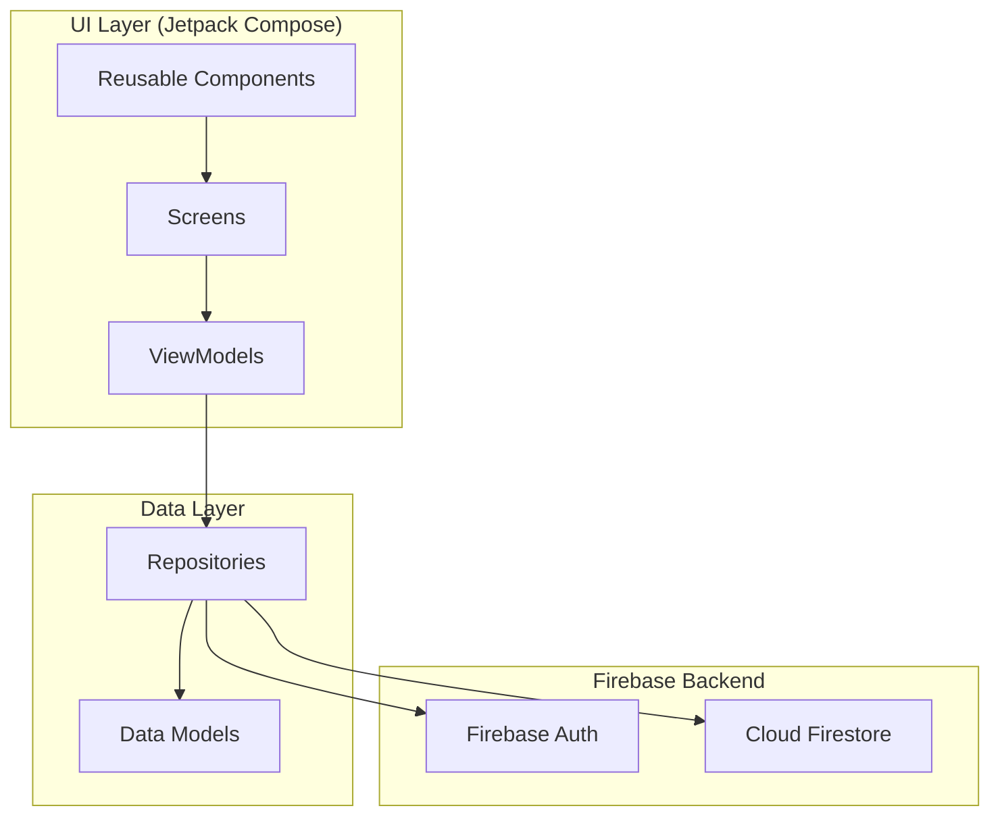
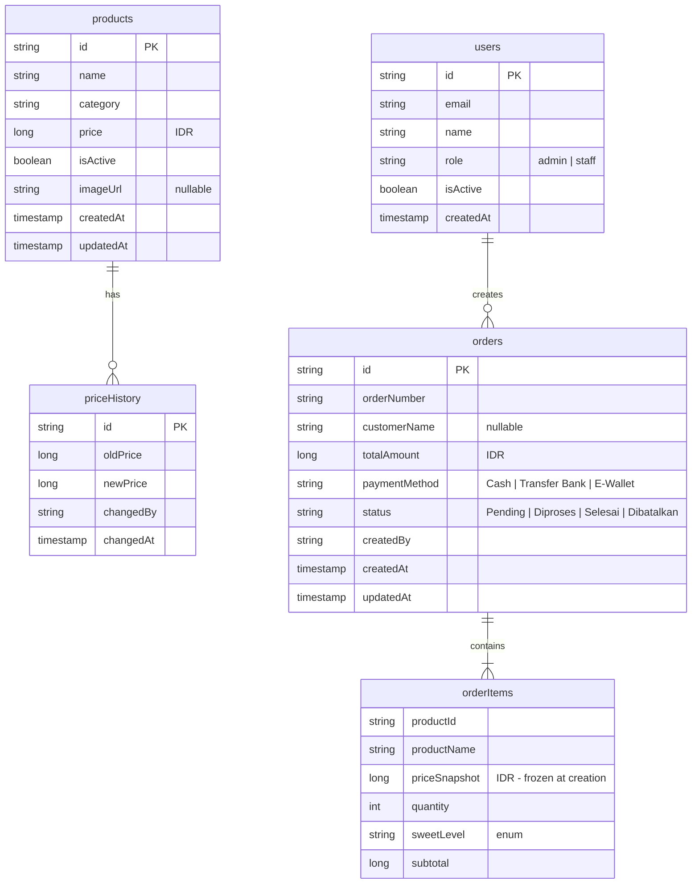
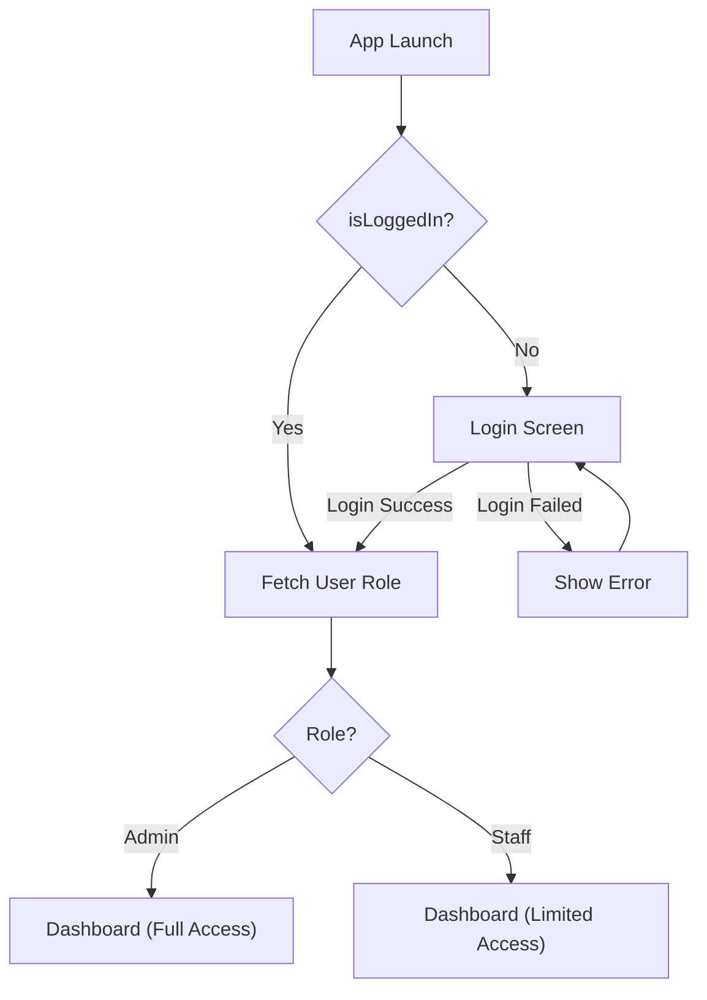
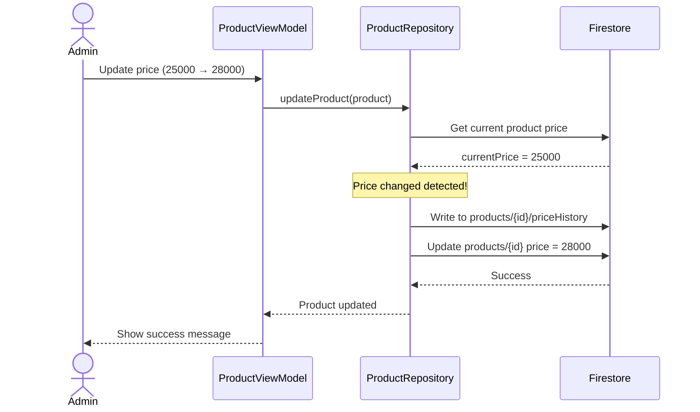
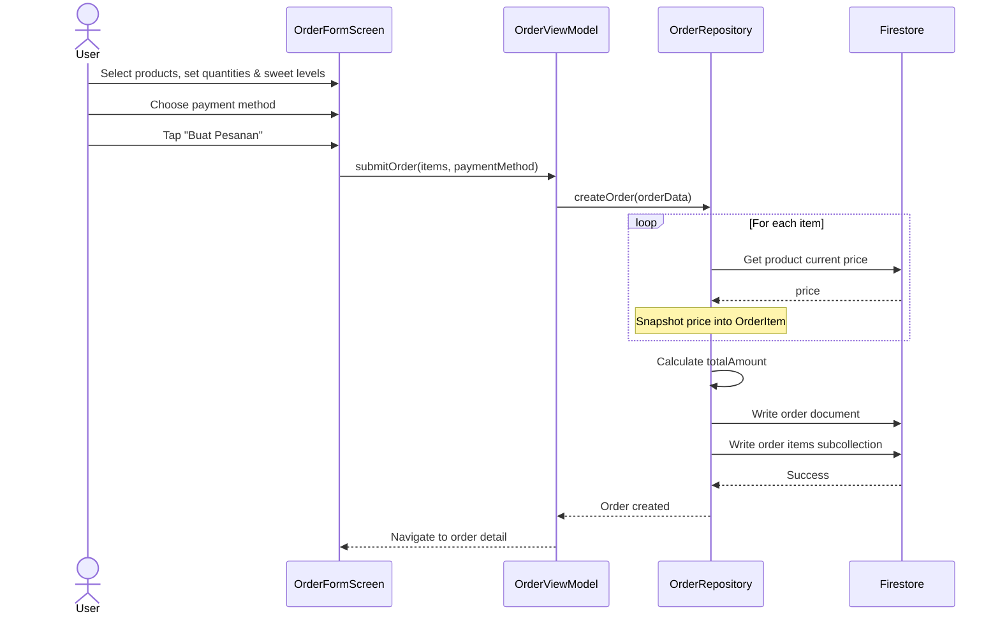
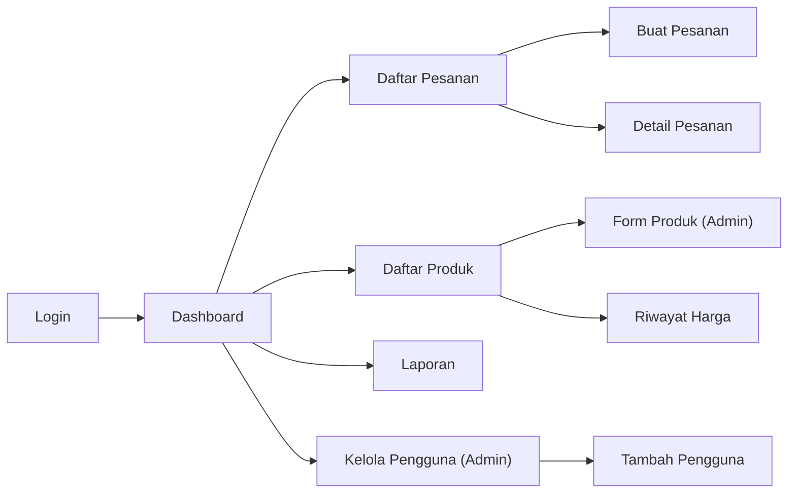

# Implementation Plan — JoyMilk Android App

> Step-by-step build plan for the JoyMilk soy milk order management app.

---

## 1. Overview

This document outlines the phased implementation plan for building the **JoyMilk** Android application — an internal order management system for a soy milk business. The plan is organized into **9 phases**, each building on the previous one, totaling approximately **50 files**.

### Architecture Summary



### Tech Stack

| Layer          | Technology                          |
|----------------|-------------------------------------|
| Language       | Kotlin                              |
| UI Framework   | Jetpack Compose + Material 3        |
| Architecture   | MVVM + Clean Architecture           |
| DI             | Hilt (Dagger)                       |
| Auth           | Firebase Authentication             |
| Database       | Cloud Firestore                     |
| Build          | Gradle (Kotlin DSL) + Version Catalog |
| Min SDK        | 26 (Android 8.0)                    |
| Target SDK     | 35                                  |

---

## 2. Prerequisites

Before starting implementation, ensure the following are in place:

- [ ] **Android Studio** — latest stable version (Ladybug or newer)
- [ ] **JDK 17+** — required by AGP 8.x
- [ ] **Firebase project created** — see [README.md](../README.md) for setup instructions
- [ ] **`google-services.json`** — downloaded from Firebase Console, placed in `app/` directory
- [ ] **First admin user** — manually created in Firebase Console (Authentication + Firestore `users` collection)

> [!IMPORTANT]
> The project **will not compile** without `google-services.json`. Create your Firebase project and download this file before running any build commands.

---

## 3. Phase 1: Project Setup & Foundation

**Goal:** Establish the project skeleton — Gradle config, application entry point, theming, and utilities.  
**Files:** ~15  
**Package base:** `com.joymilk.app`

### 3.1 Gradle Configuration

| # | File | Description |
|---|------|-------------|
| 1 | `build.gradle.kts` (root) | Project-level build config with plugin declarations (AGP, Kotlin, Hilt, Google Services, KSP) |
| 2 | `app/build.gradle.kts` | App-level config — all dependencies, `compileSdk 35`, `minSdk 26`, Compose compiler, Hilt KSP |
| 3 | `settings.gradle.kts` | Project settings with `pluginManagement` and `dependencyResolutionManagement` |
| 4 | `gradle/libs.versions.toml` | Version catalog with all dependency versions (Compose BOM, Hilt, Firebase BOM, Navigation, etc.) |
| 5 | `gradle.properties` | Gradle properties — AndroidX migration, non-transitive R classes, JVM args |
| 6 | `.gitignore` | Comprehensive Android gitignore (build/, .idea/, local.properties, google-services.json, etc.) |

### 3.2 Application & Activity

| # | File | Path | Description |
|---|------|------|-------------|
| 7 | `JoyMilkApp.kt` | `app/src/main/java/com/joymilk/app/` | `@HiltAndroidApp` application class |
| 8 | `MainActivity.kt` | `app/src/main/java/com/joymilk/app/` | `@AndroidEntryPoint` single activity with `setContent { JoyMilkTheme { ... } }` |
| 9 | `AndroidManifest.xml` | `app/src/main/` | INTERNET permission, application class reference, single activity (no `exported` launcher intent) |

### 3.3 Theme (Material 3)

| # | File | Path | Description |
|---|------|------|-------------|
| 10 | `Color.kt` | `ui/theme/` | Brand colors — greens (primary), cream (surface), brown (tertiary), status colors (pending/yellow, completed/green, cancelled/red) |
| 11 | `Theme.kt` | `ui/theme/` | `JoyMilkTheme` composable with light `ColorScheme` |
| 12 | `Type.kt` | `ui/theme/` | Material 3 typography scale |

### 3.4 Resources

| # | File | Path | Description |
|---|------|------|-------------|
| 13 | `strings.xml` | `res/values/` | All UI strings in **Bahasa Indonesia** |
| 14 | `themes.xml` | `res/values/` | XML theme fallback for splash/system UI |

### 3.5 Utilities

| # | File | Path | Description |
|---|------|------|-------------|
| 15 | `Constants.kt` | `util/` | Collection names (`users`, `products`, `orders`), sweet level labels, payment methods, order statuses |
| 16 | `CurrencyUtils.kt` | `util/` | `formatRupiah(amount: Long): String` → `"Rp 25.000"` |
| 17 | `DateUtils.kt` | `util/` | Date formatting (`dd MMM yyyy HH:mm`), range helpers for daily/weekly/monthly queries |

### ✅ Phase 1 Verification

```
✓ Project compiles without errors
✓ App launches and shows empty screen with JoyMilkTheme applied
✓ No runtime crashes
```

---

## 4. Phase 2: Data Layer

**Goal:** Define all Firestore data models and set up Hilt dependency injection.  
**Files:** ~8

### 4.1 Data Models

All models use Firestore-compatible serialization (no-arg constructors, `@DocumentId` where needed).

| # | File | Path | Description |
|---|------|------|-------------|
| 18 | `User.kt` | `data/model/` | `id`, `email`, `name`, `role` (admin/staff), `isActive`, `createdAt` |
| 19 | `Product.kt` | `data/model/` | `id`, `name`, `category`, `price` (Long/IDR), `isActive`, `imageUrl?`, `createdAt`, `updatedAt` |
| 20 | `PriceHistory.kt` | `data/model/` | `id`, `oldPrice`, `newPrice`, `changedBy`, `changedAt` — subcollection of Product |
| 21 | `Order.kt` | `data/model/` | `id`, `orderNumber`, `customerName?`, `items` (list), `totalAmount`, `paymentMethod`, `status`, `createdBy`, `createdAt`, `updatedAt` |
| 22 | `OrderItem.kt` | `data/model/` | `productId`, `productName`, `priceSnapshot` (Long), `quantity`, `sweetLevel`, `subtotal` |
| 23 | `SweetLevel.kt` | `data/model/` | Enum: `TANPA_GULA`, `LESS_SUGAR`, `NORMAL`, `EXTRA_SWEET` with `displayName` in Bahasa Indonesia |

> [!NOTE]
> **Price Snapshot Pattern:** `OrderItem.priceSnapshot` captures the product price at order creation time. This ensures historical order accuracy even when product prices change later.

### 4.2 Firestore Schema



### 4.3 DI Module

| # | File | Path | Description |
|---|------|------|-------------|
| 24 | `AppModule.kt` | `di/` | `@Module @InstallIn(SingletonComponent)` — provides `FirebaseAuth`, `FirebaseFirestore` as singletons |

### ✅ Phase 2 Verification

```
✓ All model classes compile
✓ Hilt generates DaggerApp component successfully
✓ No serialization warnings
```

---

## 5. Phase 3: Authentication

**Goal:** Implement Firebase Auth login flow with role-based routing.  
**Files:** ~4

### 5.1 Repository

| # | File | Path | Description |
|---|------|------|-------------|
| 25 | `AuthRepository.kt` | `data/repository/` | `login(email, password)`, `logout()`, `getCurrentUser()`, `getUserRole()`, `isLoggedIn()` |

### 5.2 UI

| # | File | Path | Description |
|---|------|------|-------------|
| 26 | `LoginViewModel.kt` | `ui/auth/` | `@HiltViewModel` — manages login state (idle, loading, success, error), calls `AuthRepository` |
| 27 | `LoginScreen.kt` | `ui/auth/` | Compose UI — email/password fields, login button, error display, loading indicator |

### 5.3 Navigation (Initial)

| # | File | Path | Description |
|---|------|------|-------------|
| 28 | `NavGraph.kt` | `ui/navigation/` | Initial navigation — `login` and `dashboard` routes, auth state check on launch |

### Authentication Flow



### ✅ Phase 3 Verification

```
✓ Can login with valid Firebase Auth credentials
✓ Invalid credentials show error message
✓ Successful login navigates to dashboard
✓ User role is correctly fetched from Firestore
```

---

## 6. Phase 4: Product Management — Admin Only

**Goal:** Full CRUD for products with automatic price history tracking.  
**Files:** ~5

### 6.1 Repository

| # | File | Path | Description |
|---|------|------|-------------|
| 29 | `ProductRepository.kt` | `data/repository/` | `addProduct()`, `updateProduct()`, `deleteProduct()` (soft), `getProducts()`, `getProduct()`, `updatePrice()` (auto-writes to `priceHistory` subcollection), `getPriceHistory()` |

### 6.2 UI

| # | File | Path | Description |
|---|------|------|-------------|
| 30 | `ProductViewModel.kt` | `ui/product/` | `@HiltViewModel` — product list state, form state, price history state, search/filter |
| 31 | `ProductListScreen.kt` | `ui/product/` | Product list with search bar, category filter dropdown, FAB to add (admin only) |
| 32 | `ProductFormScreen.kt` | `ui/product/` | Add/edit form — name, category, price input; price change auto-detected and logged |
| 33 | `PriceHistoryScreen.kt` | `ui/product/` | Timeline view of price changes for a product |

### Price History Auto-Tracking



### ✅ Phase 4 Verification

```
✓ Admin can add new products
✓ Admin can edit product details
✓ Price changes auto-create priceHistory entries
✓ Price history timeline displays correctly
✓ Search and category filter work
✓ Staff can view products but NOT add/edit/delete
```

---

## 7. Phase 5: Order Management

**Goal:** Create orders with price snapshots, sweet level per item, and status management.  
**Files:** ~5

### 7.1 Repository

| # | File | Path | Description |
|---|------|------|-------------|
| 34 | `OrderRepository.kt` | `data/repository/` | `createOrder()` (snapshots current prices), `getOrders()` (with date/status filters), `getOrder()`, `updateStatus()`, `generateOrderNumber()` |

### 7.2 UI

| # | File | Path | Description |
|---|------|------|-------------|
| 35 | `OrderViewModel.kt` | `ui/order/` | `@HiltViewModel` — order list, form builder (multi-item), detail state |
| 36 | `OrderListScreen.kt` | `ui/order/` | Filtered list — search by order number/customer, filter by status/date, pull-to-refresh |
| 37 | `OrderFormScreen.kt` | `ui/order/` | Multi-item order form — product picker, quantity stepper, sweet level selector per item, payment method, running total |
| 38 | `OrderDetailScreen.kt` | `ui/order/` | Detail view — items with sweet levels, prices, total, status update buttons |

### Order Creation Flow



### Sweet Level Options

| Enum Value | Display (Bahasa) | Price Impact |
|------------|-------------------|--------------|
| `TANPA_GULA` | Tanpa Gula | None |
| `LESS_SUGAR` | Less Sugar | None |
| `NORMAL` | Normal | None |
| `EXTRA_SWEET` | Extra Sweet | None |

> [!NOTE]
> Sweet level is a **preference only** — it does not affect pricing. It is stored per `OrderItem` to accurately fulfill each item in the order.

### ✅ Phase 5 Verification

```
✓ Can create multi-item orders
✓ Price snapshots are frozen at creation time
✓ Sweet level selector works per item
✓ All 3 payment methods available (Cash, Transfer Bank, E-Wallet)
✓ Order status can be updated (Pending → Diproses → Selesai / Dibatalkan)
✓ Search and filter work on order list
```

---

## 8. Phase 6: Dashboard & Reports

**Goal:** Today's summary dashboard and daily/weekly/monthly report screens.  
**Files:** ~4

### 8.1 Repository

| # | File | Path | Description |
|---|------|------|-------------|
| 39 | `ReportRepository.kt` | `data/repository/` | `getDailySummary(date)`, `getWeeklySummary(weekStart)`, `getMonthlySummary(month, year)`, `getTopProducts(period)` — aggregation queries on orders collection |

### 8.2 UI

| # | File | Path | Description |
|---|------|------|-------------|
| 40 | `DashboardViewModel.kt` | `ui/dashboard/` | `@HiltViewModel` — today's order count, revenue, pending orders |
| 41 | `DashboardScreen.kt` | `ui/dashboard/` | Summary cards (total pesanan, pendapatan, pesanan pending), quick action buttons, recent orders list |
| 42 | `ReportViewModel.kt` | `ui/report/` | `@HiltViewModel` — report data with period selection state |
| 43 | `ReportScreen.kt` | `ui/report/` | Tab layout (Harian / Mingguan / Bulanan), summary stats, produk terlaris list, revenue breakdown |

### Dashboard Layout

```
┌─────────────────────────────────────┐
│  JoyMilk Dashboard        [Logout] │
├─────────────────────────────────────┤
│  ┌──────────┐  ┌──────────────────┐ │
│  │ Pesanan  │  │   Pendapatan     │ │
│  │ Hari Ini │  │   Hari Ini       │ │
│  │   12     │  │   Rp 450.000     │ │
│  └──────────┘  └──────────────────┘ │
│  ┌──────────────────────────────────┤
│  │ Pesanan Pending: 3              │ │
│  └──────────────────────────────────┤
│                                     │
│  Quick Actions                      │
│  [+ Pesanan Baru]  [📦 Produk]     │
│  [📊 Laporan]      [👥 Pengguna]   │
│                                     │
│  Pesanan Terbaru                    │
│  ┌─────────────────────────────────┐│
│  │ #JM-20261110-001  Rp 75.000    ││
│  │ 3 item • Pending • 08:30       ││
│  ├─────────────────────────────────┤│
│  │ #JM-20261110-002  Rp 50.000    ││
│  │ 2 item • Selesai • 09:15       ││
│  └─────────────────────────────────┘│
└─────────────────────────────────────┘
```

### ✅ Phase 6 Verification

```
✓ Dashboard shows today's order count and revenue
✓ Pending order count is accurate
✓ Recent orders list loads correctly
✓ Report tabs switch between daily/weekly/monthly
✓ Top products (produk terlaris) list is accurate
✓ Revenue totals match sum of completed orders
```

---

## 9. Phase 7: User Management

**Goal:** Admin can manage staff accounts.  
**Files:** ~3

### 9.1 Repository

| # | File | Path | Description |
|---|------|------|-------------|
| 44 | `UserRepository.kt` | `data/repository/` | `getUsers()`, `addUser()`, `updateUser()`, `toggleActive()` |

### 9.2 UI

| # | File | Path | Description |
|---|------|------|-------------|
| 45 | `UserViewModel.kt` | `ui/user/` | `@HiltViewModel` — user list state management |
| 46 | `UserListScreen.kt` | `ui/user/` | User list with role badges, active/inactive toggle switch |
| 47 | `UserFormScreen.kt` | `ui/user/` | Add user form — name, email, role selector (admin/staff) |

### Role-Based Access Matrix

| Feature | Admin | Staff |
|---------|-------|-------|
| Dashboard | ✅ Full | ✅ Full |
| Create Orders | ✅ | ✅ |
| View Orders | ✅ All | ✅ All |
| Update Order Status | ✅ | ✅ |
| View Products | ✅ | ✅ |
| Add/Edit Products | ✅ | ❌ |
| Delete Products | ✅ | ❌ |
| View Reports | ✅ | ✅ |
| Manage Users | ✅ | ❌ |

### ✅ Phase 7 Verification

```
✓ Admin can view user list
✓ Admin can add new users
✓ Admin can toggle user active/inactive
✓ Staff cannot access user management
✓ Deactivated users cannot login
```

---

## 10. Phase 8: Components & Polish

**Goal:** Extract reusable components, finalize navigation with role-based gating.  
**Files:** ~5 new + 1 modified

### 10.1 Reusable Components

| # | File | Path | Description |
|---|------|------|-------------|
| 48 | `JoyMilkTopBar.kt` | `ui/components/` | Custom `TopAppBar` with back navigation, title, optional actions |
| 49 | `OrderCard.kt` | `ui/components/` | Order list item — order number, item count, total, status chip, timestamp |
| 50 | `ProductCard.kt` | `ui/components/` | Product list item — name, category, price formatted in Rupiah |
| 51 | `StatusChip.kt` | `ui/components/` | Colored chip for order status (Pending=yellow, Diproses=blue, Selesai=green, Dibatalkan=red) |
| 52 | `LoadingIndicator.kt` | `ui/components/` | Reusable loading states — full screen spinner, inline loading |

### 10.2 Navigation Update

| # | File | Action | Description |
|---|------|--------|-------------|
| 28 | `NavGraph.kt` | **MODIFY** | Complete navigation graph with all routes, role-based access guards, bottom navigation |

### Complete Navigation Map



### ✅ Phase 8 Verification

```
✓ All navigation routes work correctly
✓ Back navigation behaves properly
✓ Role-based routes are hidden/blocked for staff
✓ Components render consistently across screens
✓ Loading states appear during data fetches
✓ Error states display meaningful messages
```

---

## 11. Phase 9: Documentation

**Goal:** Complete all project documentation.  
**Files:** ~5

| # | File | Action | Description |
|---|------|--------|-------------|
| — | `README.md` | **MODIFY** | Update with final setup instructions, screenshots, and feature list |
| — | `AGENTS.md` | **NEW** | AI agent coding guidelines |
| — | `CLAUDE.md` | **NEW** | Claude-specific project context |
| — | `docs/IMPLEMENTATION_PLAN.md` | **EXISTS** | This document |
| — | `docs/FIRESTORE_SCHEMA.md` | **NEW** | Detailed Firestore schema documentation |

### ✅ Phase 9 Verification

```
✓ README.md has accurate setup instructions
✓ All docs reflect final implementation
✓ AGENTS.md covers coding conventions
```

---

## 12. File Checklist

Complete list of all files to be created/modified across all phases.

### Phase 1: Project Setup & Foundation

| # | File | Phase | Status |
|---|------|-------|--------|
| 1 | `build.gradle.kts` (root) | 1 | To Do |
| 2 | `app/build.gradle.kts` | 1 | To Do |
| 3 | `settings.gradle.kts` | 1 | To Do |
| 4 | `gradle/libs.versions.toml` | 1 | To Do |
| 5 | `gradle.properties` | 1 | To Do |
| 6 | `.gitignore` | 1 | To Do |
| 7 | `app/src/main/AndroidManifest.xml` | 1 | To Do |
| 8 | `app/src/main/java/com/joymilk/app/JoyMilkApp.kt` | 1 | To Do |
| 9 | `app/src/main/java/com/joymilk/app/MainActivity.kt` | 1 | To Do |
| 10 | `app/src/main/java/com/joymilk/app/ui/theme/Color.kt` | 1 | To Do |
| 11 | `app/src/main/java/com/joymilk/app/ui/theme/Theme.kt` | 1 | To Do |
| 12 | `app/src/main/java/com/joymilk/app/ui/theme/Type.kt` | 1 | To Do |
| 13 | `app/src/main/res/values/strings.xml` | 1 | To Do |
| 14 | `app/src/main/res/values/themes.xml` | 1 | To Do |
| 15 | `app/src/main/java/com/joymilk/app/util/Constants.kt` | 1 | To Do |
| 16 | `app/src/main/java/com/joymilk/app/util/CurrencyUtils.kt` | 1 | To Do |
| 17 | `app/src/main/java/com/joymilk/app/util/DateUtils.kt` | 1 | To Do |

### Phase 2: Data Layer

| # | File | Phase | Status |
|---|------|-------|--------|
| 18 | `app/src/main/java/com/joymilk/app/data/model/User.kt` | 2 | To Do |
| 19 | `app/src/main/java/com/joymilk/app/data/model/Product.kt` | 2 | To Do |
| 20 | `app/src/main/java/com/joymilk/app/data/model/PriceHistory.kt` | 2 | To Do |
| 21 | `app/src/main/java/com/joymilk/app/data/model/Order.kt` | 2 | To Do |
| 22 | `app/src/main/java/com/joymilk/app/data/model/OrderItem.kt` | 2 | To Do |
| 23 | `app/src/main/java/com/joymilk/app/data/model/SweetLevel.kt` | 2 | To Do |
| 24 | `app/src/main/java/com/joymilk/app/di/AppModule.kt` | 2 | To Do |

### Phase 3: Authentication

| # | File | Phase | Status |
|---|------|-------|--------|
| 25 | `app/src/main/java/com/joymilk/app/data/repository/AuthRepository.kt` | 3 | To Do |
| 26 | `app/src/main/java/com/joymilk/app/ui/auth/LoginViewModel.kt` | 3 | To Do |
| 27 | `app/src/main/java/com/joymilk/app/ui/auth/LoginScreen.kt` | 3 | To Do |
| 28 | `app/src/main/java/com/joymilk/app/ui/navigation/NavGraph.kt` | 3 | To Do |

### Phase 4: Product Management

| # | File | Phase | Status |
|---|------|-------|--------|
| 29 | `app/src/main/java/com/joymilk/app/data/repository/ProductRepository.kt` | 4 | To Do |
| 30 | `app/src/main/java/com/joymilk/app/ui/product/ProductViewModel.kt` | 4 | To Do |
| 31 | `app/src/main/java/com/joymilk/app/ui/product/ProductListScreen.kt` | 4 | To Do |
| 32 | `app/src/main/java/com/joymilk/app/ui/product/ProductFormScreen.kt` | 4 | To Do |
| 33 | `app/src/main/java/com/joymilk/app/ui/product/PriceHistoryScreen.kt` | 4 | To Do |

### Phase 5: Order Management

| # | File | Phase | Status |
|---|------|-------|--------|
| 34 | `app/src/main/java/com/joymilk/app/data/repository/OrderRepository.kt` | 5 | To Do |
| 35 | `app/src/main/java/com/joymilk/app/ui/order/OrderViewModel.kt` | 5 | To Do |
| 36 | `app/src/main/java/com/joymilk/app/ui/order/OrderListScreen.kt` | 5 | To Do |
| 37 | `app/src/main/java/com/joymilk/app/ui/order/OrderFormScreen.kt` | 5 | To Do |
| 38 | `app/src/main/java/com/joymilk/app/ui/order/OrderDetailScreen.kt` | 5 | To Do |

### Phase 6: Dashboard & Reports

| # | File | Phase | Status |
|---|------|-------|--------|
| 39 | `app/src/main/java/com/joymilk/app/data/repository/ReportRepository.kt` | 6 | To Do |
| 40 | `app/src/main/java/com/joymilk/app/ui/dashboard/DashboardViewModel.kt` | 6 | To Do |
| 41 | `app/src/main/java/com/joymilk/app/ui/dashboard/DashboardScreen.kt` | 6 | To Do |
| 42 | `app/src/main/java/com/joymilk/app/ui/report/ReportViewModel.kt` | 6 | To Do |
| 43 | `app/src/main/java/com/joymilk/app/ui/report/ReportScreen.kt` | 6 | To Do |

### Phase 7: User Management

| # | File | Phase | Status |
|---|------|-------|--------|
| 44 | `app/src/main/java/com/joymilk/app/data/repository/UserRepository.kt` | 7 | To Do |
| 45 | `app/src/main/java/com/joymilk/app/ui/user/UserViewModel.kt` | 7 | To Do |
| 46 | `app/src/main/java/com/joymilk/app/ui/user/UserListScreen.kt` | 7 | To Do |
| 47 | `app/src/main/java/com/joymilk/app/ui/user/UserFormScreen.kt` | 7 | To Do |

### Phase 8: Components & Polish

| # | File | Phase | Status |
|---|------|-------|--------|
| 48 | `app/src/main/java/com/joymilk/app/ui/components/JoyMilkTopBar.kt` | 8 | To Do |
| 49 | `app/src/main/java/com/joymilk/app/ui/components/OrderCard.kt` | 8 | To Do |
| 50 | `app/src/main/java/com/joymilk/app/ui/components/ProductCard.kt` | 8 | To Do |
| 51 | `app/src/main/java/com/joymilk/app/ui/components/StatusChip.kt` | 8 | To Do |
| 52 | `app/src/main/java/com/joymilk/app/ui/components/LoadingIndicator.kt` | 8 | To Do |
| 28 | `app/src/main/java/com/joymilk/app/ui/navigation/NavGraph.kt` | 8 | To Do (MODIFY) |

### Phase 9: Documentation

| # | File | Phase | Status |
|---|------|-------|--------|
| — | `README.md` | 9 | To Do (MODIFY) |
| — | `AGENTS.md` | 9 | To Do |
| — | `CLAUDE.md` | 9 | To Do |
| — | `docs/IMPLEMENTATION_PLAN.md` | 9 | ✅ Done |
| — | `docs/FIRESTORE_SCHEMA.md` | 9 | To Do |

---

## 13. Testing Strategy

Since this is a small internal app (2-5 users), the testing strategy focuses on manual verification with systematic coverage.

### Per-Phase Testing

Each phase must pass its verification checklist before proceeding to the next phase.

### Integration Testing Scenarios

| # | Scenario | Steps | Expected Result |
|---|----------|-------|-----------------|
| 1 | Price Snapshot Integrity | Create order → Change product price → View order | Order shows original price |
| 2 | Role-Based Access | Login as staff → Try to access product form | Should be blocked/hidden |
| 3 | Order Lifecycle | Create → Diproses → Selesai | Status updates correctly |
| 4 | Price History | Edit product price 3 times → View history | 3 entries with correct old/new prices |
| 5 | Report Accuracy | Create 5 orders today → Check daily report | Count=5, revenue=sum of totals |
| 6 | User Deactivation | Deactivate user → Try login | Login should fail |
| 7 | Sweet Level Persistence | Create order with mixed sweet levels → View detail | Each item shows correct sweet level |

### Firebase Emulator Testing

For local development without affecting production data:

```bash
# Install Firebase CLI
npm install -g firebase-tools

# Initialize emulators
firebase init emulators

# Start emulators (Auth + Firestore)
firebase emulators:start
```

Configure the app to use emulators in debug builds:

```kotlin
// In AppModule.kt (debug only)
Firebase.firestore.useEmulator("10.0.2.2", 8080)
Firebase.auth.useEmulator("10.0.2.2", 9099)
```

---

## 14. Known Risks & Mitigations

| Risk | Impact | Mitigation |
|------|--------|------------|
| Missing `google-services.json` | Build fails | Document clearly in README; add to `.gitignore` with setup instructions |
| Firestore composite indexes | Queries fail at runtime | Create indexes proactively; document required indexes in `FIRESTORE_SCHEMA.md` |
| First admin user bootstrap | No one can login initially | Document manual creation steps in Firebase Console |
| Firestore read/write costs | Unexpected billing | Use query limits, pagination; free tier sufficient for 2-5 users |
| Offline mode complexity | Data conflicts on sync | Rely on Firestore built-in offline support; keep data model simple |
| No automated tests | Regression risk | Strict per-phase manual verification; keep codebase small and readable |

---

## 15. Implementation Notes

### Money Handling
All monetary values are stored as `Long` (IDR, no cents). Never use `Float` or `Double` for money.

```kotlin
// ✅ Correct
val price: Long = 25000L
val formatted = formatRupiah(price) // "Rp 25.000"

// ❌ Wrong — never do this
val price: Double = 25000.0
```

### Firestore Collection Names
Defined in `Constants.kt` to avoid typos:

```kotlin
object Collections {
    const val USERS = "users"
    const val PRODUCTS = "products"
    const val ORDERS = "orders"
    const val PRICE_HISTORY = "priceHistory"
    const val ORDER_ITEMS = "items"
}
```

### Order Number Format
Auto-generated: `JM-YYYYMMDD-NNN` (e.g., `JM-20261110-001`)

### Bahasa Indonesia UI Labels
All user-facing strings are in Bahasa Indonesia, defined in `strings.xml`:
- Pesanan = Orders
- Produk = Products
- Laporan = Reports
- Pengguna = Users
- Pendapatan = Revenue
- Harian / Mingguan / Bulanan = Daily / Weekly / Monthly

