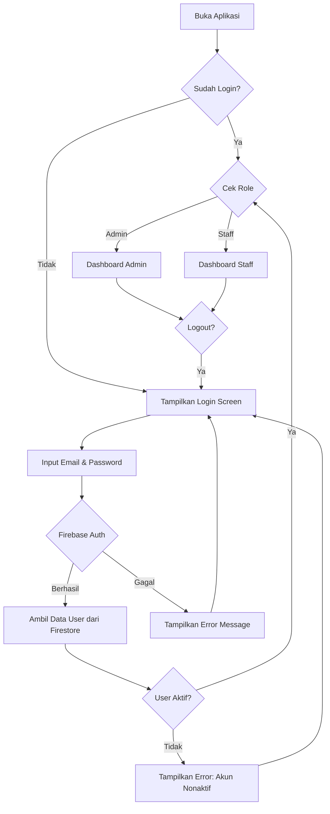
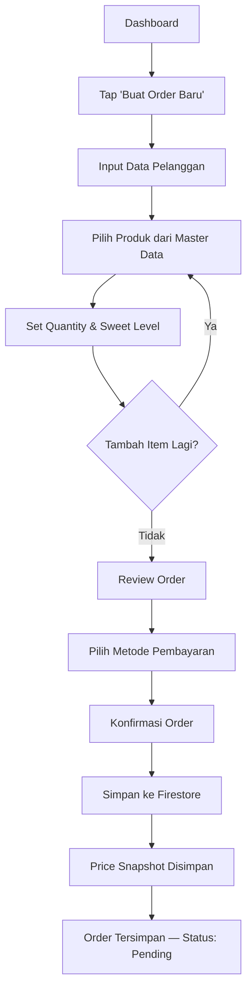
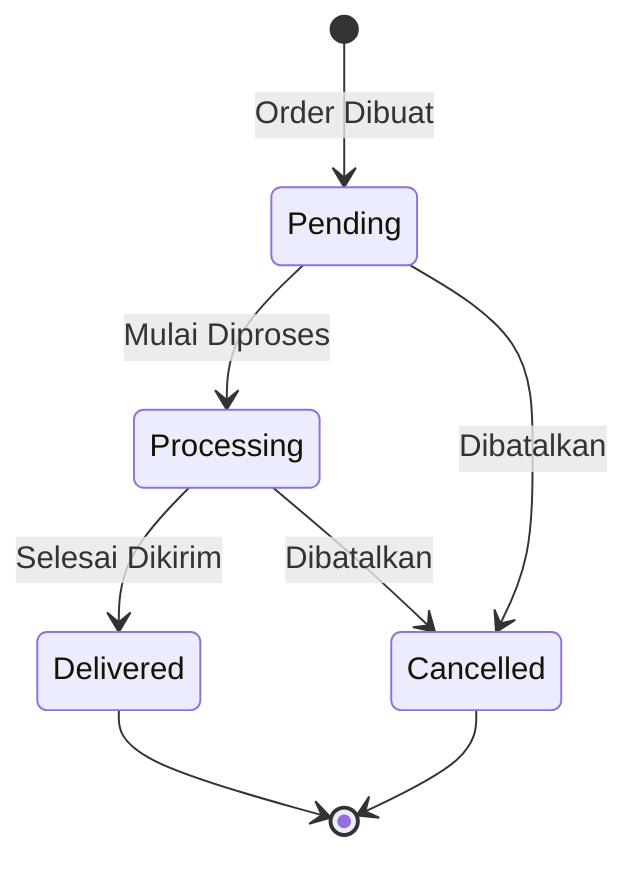
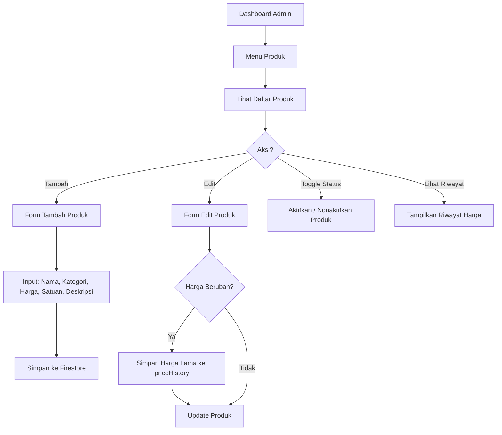
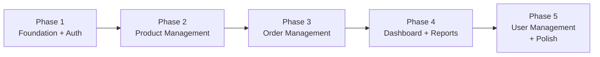
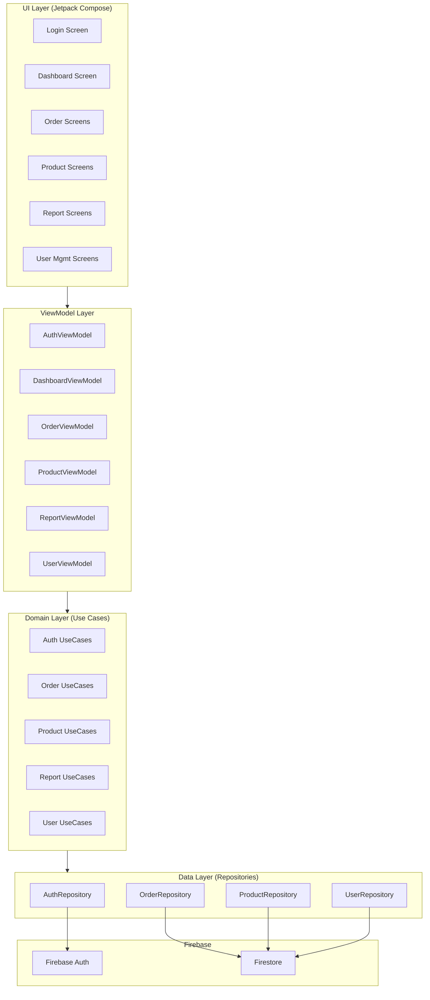
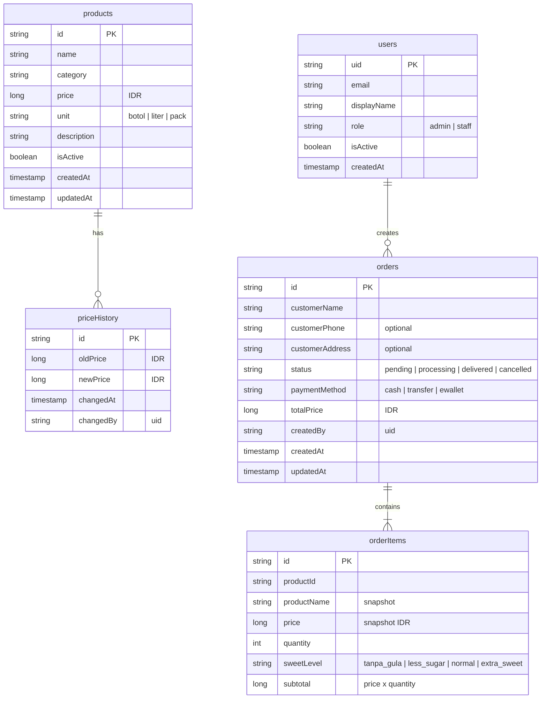

# PRD — JoyMilk: Aplikasi Pencatatan Order Susu Kedelai

> **Versi Dokumen:** 1.0  
> **Terakhir Diperbarui:** 10 November 2026  
> **Status:** Draft  
> **Penulis:** Tim JoyMilk

---

## 1. Ringkasan Produk

| Aspek | Detail |
|---|---|
| **Nama Aplikasi** | JoyMilk |
| **Tipe** | Aplikasi Android internal |
| **Target User** | Tim internal bisnis susu kedelai (2–5 orang) |
| **Tujuan** | Pencatatan orderan, manajemen produk, dan laporan penjualan |
| **Tech Stack** | Kotlin, Jetpack Compose, Material 3, Firebase (Firestore + Auth) |
| **Arsitektur** | MVVM + Clean Architecture, Hilt DI |
| **Package** | `com.joymilk.app` |
| **Bahasa UI** | Bahasa Indonesia |
| **Mata Uang** | IDR (Rupiah), disimpan sebagai `Long` |

JoyMilk adalah aplikasi Android internal yang dirancang untuk mendigitalisasi proses pencatatan order pada bisnis susu kedelai. Aplikasi ini memungkinkan tim kecil (2–5 orang) untuk mencatat order, mengelola master data produk, dan melihat laporan penjualan — semuanya tersinkronisasi secara real-time melalui Firebase Firestore.

---

## 2. Latar Belakang & Masalah

### Konteks Bisnis

Bisnis susu kedelai skala kecil–menengah sering kali masih mengandalkan pencatatan manual (buku tulis, spreadsheet) untuk mengelola order dan penjualan. Seiring pertumbuhan bisnis, metode ini menimbulkan berbagai kendala.

### Masalah yang Dihadapi

| # | Masalah | Dampak |
|---|---|---|
| 1 | Pencatatan order manual (buku/kertas) | Rawan kesalahan tulis, data hilang, sulit dilacak |
| 2 | Tidak ada sistem terpusat | Setiap anggota tim punya catatan sendiri-sendiri |
| 3 | Butuh akses dari beberapa device | Tidak bisa koordinasi real-time antar anggota tim |
| 4 | Tidak ada laporan penjualan otomatis | Analisis bisnis sulit, harus rekap manual |
| 5 | Tidak ada riwayat harga | Sulit melacak perubahan harga produk dari waktu ke waktu |

### Solusi

Membangun aplikasi Android internal yang:

- Mencatat semua order secara digital
- Tersinkronisasi otomatis antar device via cloud (Firestore)
- Mengelola master data produk dengan riwayat harga
- Menghasilkan laporan penjualan harian, mingguan, dan bulanan
- Mengatur akses berdasarkan role (admin/staff)

---

## 3. Target Pengguna & Persona

### Persona 1: Admin (Pemilik Bisnis)

| Aspek | Detail |
|---|---|
| **Role** | `admin` |
| **Jumlah** | 1–2 orang |
| **Profil** | Pemilik bisnis susu kedelai |
| **Kebutuhan** | Kelola master data produk, lihat laporan lengkap, kelola user |
| **Akses** | Full CRUD — semua fitur tersedia |
| **Contoh Task** | Tambah produk baru, ubah harga, lihat rekap penjualan bulanan, tambah staff baru |

### Persona 2: Staff (Karyawan)

| Aspek | Detail |
|---|---|
| **Role** | `staff` |
| **Jumlah** | 1–3 orang |
| **Profil** | Karyawan yang menangani order harian |
| **Kebutuhan** | Input order, lihat daftar produk, lihat laporan terbatas |
| **Akses** | Orders (CRUD) + Products (read-only) |
| **Contoh Task** | Catat order pelanggan, cek harga produk, lihat rekap harian |

### Matriks Akses Role

| Fitur | Admin | Staff |
|---|:---:|:---:|
| Login / Logout | ✅ | ✅ |
| Dashboard | ✅ | ✅ |
| Input Order | ✅ | ✅ |
| Edit / Cancel Order | ✅ | ✅ |
| Lihat Daftar Produk | ✅ | ✅ (read-only) |
| CRUD Produk | ✅ | ❌ |
| Riwayat Harga Produk | ✅ | ❌ |
| Laporan Lengkap | ✅ | ✅ (terbatas) |
| User Management | ✅ | ❌ |

---

## 4. Fitur & Requirements

### 4.1 Autentikasi (P0 — Must Have)

**Deskripsi:** Sistem login berbasis email/password menggunakan Firebase Authentication dengan role-based access control.

**Requirements:**

| ID | Requirement | Prioritas |
|---|---|:---:|
| AUTH-01 | Login dengan email dan password via Firebase Auth | P0 |
| AUTH-02 | Role-based access control: `admin` dan `staff` | P0 |
| AUTH-03 | Auto-login: user tetap logged in setelah restart app | P0 |
| AUTH-04 | Logout: hapus session dan kembali ke login screen | P0 |
| AUTH-05 | Tampilkan error message yang jelas saat login gagal | P0 |
| AUTH-06 | Role disimpan di Firestore collection `users` | P0 |

**User Flow — Autentikasi:**

---

### 4.2 Dashboard (P0 — Must Have)

**Deskripsi:** Halaman utama yang menampilkan ringkasan aktivitas hari ini dan akses cepat ke fitur utama.

**Requirements:**

| ID | Requirement | Prioritas |
|---|---|:---:|
| DASH-01 | Tampilkan jumlah order hari ini | P0 |
| DASH-02 | Tampilkan total penjualan hari ini (IDR) | P0 |
| DASH-03 | Quick action buttons: Buat Order Baru, Lihat Produk | P0 |
| DASH-04 | Navigation hub ke semua fitur utama | P0 |
| DASH-05 | Tampilkan informasi role user yang sedang login | P0 |

---

### 4.3 Manajemen Order (P0 — Must Have)

**Deskripsi:** Fitur inti untuk mencatat, mengelola, dan melacak order pelanggan. Menggunakan **price snapshot pattern** — harga produk di-freeze saat order dibuat sehingga perubahan harga di master data tidak mempengaruhi order yang sudah tercatat.

**Requirements:**

| ID | Requirement | Prioritas |
|---|---|:---:|
| ORD-01 | Input data pelanggan: nama (wajib), telepon (opsional), alamat (opsional) | P0 |
| ORD-02 | Multi-item per order, dipilih dari master data produk aktif | P0 |
| ORD-03 | Sweet level per item: Tanpa Gula / Less Sugar / Normal / Extra Sweet | P0 |
| ORD-04 | Sweet level adalah preferensi saja, **tidak mempengaruhi harga** | P0 |
| ORD-05 | Harga otomatis diambil dari master data saat order dibuat (price snapshot) | P0 |
| ORD-06 | Total harga dihitung otomatis dari semua item | P0 |
| ORD-07 | Metode pembayaran: Cash, Transfer Bank, E-Wallet | P0 |
| ORD-08 | Status order: Pending → Processing → Delivered / Cancelled | P0 |
| ORD-09 | Filter & search order (by nama, status, tanggal) | P0 |
| ORD-10 | Edit order hanya jika status masih **Pending** | P0 |
| ORD-11 | Catat waktu pembuatan order (`createdAt`) | P0 |
| ORD-12 | Catat user yang membuat order (`createdBy`) | P0 |

> [!IMPORTANT]
> **Price Snapshot Pattern:** Saat order dibuat, harga setiap item di-copy dari master data produk dan disimpan di subcollection `orders/{id}/items`. Ini memastikan laporan dan riwayat order selalu menampilkan harga yang benar pada saat transaksi, meskipun harga produk berubah di kemudian hari.

**User Flow — Buat Order Baru:**

**State Diagram — Status Order:**

---

### 4.4 Master Data Produk — Admin Only (P0 — Must Have)

**Deskripsi:** Pengelolaan data produk susu kedelai termasuk harga, kategori, dan riwayat perubahan harga. Hanya bisa diakses oleh admin.

**Requirements:**

| ID | Requirement | Prioritas |
|---|---|:---:|
| PROD-01 | CRUD produk: nama, kategori, harga, satuan, deskripsi | P0 |
| PROD-02 | Satuan produk: botol, liter, pack | P0 |
| PROD-03 | Aktifkan / nonaktifkan produk (soft delete) | P0 |
| PROD-04 | Otomatis simpan riwayat perubahan harga di subcollection `priceHistory` | P0 |
| PROD-05 | Lihat riwayat harga per produk (dari harga lama ke harga baru + tanggal) | P0 |
| PROD-06 | Staff hanya bisa melihat daftar produk aktif (read-only) | P0 |
| PROD-07 | Harga disimpan sebagai `Long` dalam satuan IDR (tanpa floating point) | P0 |
| PROD-08 | Kategori produk didukung (misal: Original, Rasa, Premium) | P0 |

**User Flow — Kelola Produk (Admin):**

---

### 4.5 Laporan / Rekap (P1 — Should Have)

**Deskripsi:** Fitur laporan penjualan untuk analisis bisnis. Harga di laporan selalu menggunakan harga dari price snapshot (harga saat transaksi), bukan harga terkini di master data.

**Requirements:**

| ID | Requirement | Prioritas |
|---|---|:---:|
| RPT-01 | Rekap harian: total order & total penjualan hari ini | P1 |
| RPT-02 | Rekap mingguan: total order & total penjualan minggu ini | P1 |
| RPT-03 | Rekap bulanan: total order & total penjualan bulan ini | P1 |
| RPT-04 | Produk terlaris berdasarkan jumlah quantity terjual | P1 |
| RPT-05 | Filter laporan berdasarkan rentang tanggal (date range) | P1 |
| RPT-06 | Harga di laporan menggunakan price snapshot dari order | P1 |
| RPT-07 | Hanya menghitung order dengan status **Delivered** | P1 |

---

### 4.6 User Management — Admin Only (P1 — Should Have)

**Deskripsi:** Pengelolaan akun user oleh admin. User baru dibuat oleh admin dengan role yang ditentukan.

**Requirements:**

| ID | Requirement | Prioritas |
|---|---|:---:|
| USR-01 | Lihat daftar semua user yang terdaftar | P1 |
| USR-02 | Tambah user baru dengan email, password awal, dan role | P1 |
| USR-03 | Aktifkan / nonaktifkan user (block access tanpa hapus akun) | P1 |
| USR-04 | Tampilkan informasi role dan status setiap user | P1 |

---

### 4.7 Fitur Non-Fungsional

| ID | Requirement | Detail | Prioritas |
|---|---|---|:---:|
| NF-01 | Offline Support | Firestore offline persistence — app tetap bisa digunakan tanpa internet, sync otomatis saat online | P0 |
| NF-02 | Real-time Sync | Data tersinkronisasi secara real-time antar device menggunakan Firestore snapshot listener | P0 |
| NF-03 | Min SDK | API 26 (Android 8.0 Oreo) | P0 |
| NF-04 | Bahasa UI | Bahasa Indonesia | P0 |
| NF-05 | Mata Uang | IDR (Rupiah), disimpan sebagai `Long` | P0 |
| NF-06 | Performa | App launch < 3 detik, navigasi halaman < 1 detik | P1 |
| NF-07 | Keamanan | Firebase Security Rules untuk enforce role-based access | P0 |

---

## 5. Out of Scope (v1)

Fitur-fitur berikut **tidak** termasuk dalam scope versi pertama (v1) JoyMilk:

| Fitur | Alasan |
|---|---|
| 🍎 iOS Support | Fokus ke Android untuk tim internal |
| 👤 Customer-Facing App | App hanya untuk internal, bukan untuk pelanggan |
| 💳 Online Payment Gateway | Pembayaran dicatat manual (cash/transfer/e-wallet) |
| 🔔 Push Notifications | Belum dibutuhkan untuk skala 2–5 user |
| 📄 Export PDF / Excel | Laporan cukup dilihat di app untuk v1 |
| 🏢 Multi-Branch / Outlet Support | Saat ini hanya satu outlet |
| 📊 Grafik / Chart Penjualan | Cukup tabel rekap untuk v1 |
| 🖼️ Foto Produk | Tidak diperlukan untuk operasional internal |

---

## 6. Success Metrics

| # | Metrik | Target | Cara Ukur |
|---|---|---|---|
| 1 | **Zero Paper** | 100% order tercatat digital | Tidak ada pencatatan manual lagi |
| 2 | **Rekap Real-time** | Laporan penjualan tersedia kapan saja | Dashboard & halaman laporan |
| 3 | **Data Sync** | Data tersinkronisasi antar semua device tim | Perubahan di satu device terlihat di device lain < 5 detik |
| 4 | **Adopsi Tim** | Semua anggota tim menggunakan app | 100% user aktif login dan input order |
| 5 | **Akurasi Data** | Tidak ada mismatch harga di laporan | Price snapshot memastikan harga order = harga saat transaksi |

---

## 7. Timeline & Milestones

### Detail Per Phase

| Phase | Nama | Scope | Deliverable |
|:---:|---|---|---|
| **1** | Foundation + Auth | Setup project, Firebase config, login/logout, role check | App bisa login, routing by role |
| **2** | Product Management | CRUD produk, kategori, riwayat harga, role guard | Admin bisa kelola master data produk |
| **3** | Order Management | Input order, multi-item, sweet level, price snapshot, status flow | Order bisa dicatat dan dikelola |
| **4** | Dashboard + Reports | Dashboard ringkasan, rekap harian/mingguan/bulanan, filter | Laporan penjualan tersedia |
| **5** | User Management + Polish | CRUD user, UI polish, testing, bug fixing | App siap digunakan sehari-hari |

---

## 8. Risiko & Mitigasi

| # | Risiko | Probabilitas | Dampak | Mitigasi |
|---|---|:---:|:---:|---|
| 1 | **Firebase free tier limits** | Rendah | Sedang | Monitor usage via Firebase Console; upgrade ke Blaze plan jika mendekati limit. Dengan 2–5 user, free tier seharusnya cukup. |
| 2 | **Offline data conflict** | Rendah | Rendah | Firestore handles merge secara otomatis dengan last-write-wins. Konflik jarang terjadi dengan jumlah user sedikit. |
| 3 | **Data loss** | Sangat Rendah | Tinggi | Aktifkan Firestore backup/export rules. Data tersimpan di cloud Firebase dengan redundansi bawaan Google Cloud. |
| 4 | **User adoption resistance** | Sedang | Sedang | UI dibuat sesederhana mungkin. Pelatihan singkat untuk tim. Bahasa Indonesia agar mudah dipahami. |
| 5 | **Perubahan requirement** | Sedang | Sedang | Arsitektur Clean Architecture memudahkan perubahan. Scope v1 dijaga ketat, fitur tambahan masuk ke backlog v2. |
| 6 | **Security breach** | Rendah | Tinggi | Firebase Security Rules enforce role-based access. Semua operasi sensitif hanya bisa dilakukan oleh admin. |

---

## Lampiran: Arsitektur Tingkat Tinggi

### Firestore Collections

---

> [!NOTE]
> Dokumen ini adalah _living document_ yang akan diperbarui seiring perkembangan proyek. Semua perubahan signifikan harus didiskusikan dan disetujui oleh stakeholder sebelum implementasi.
