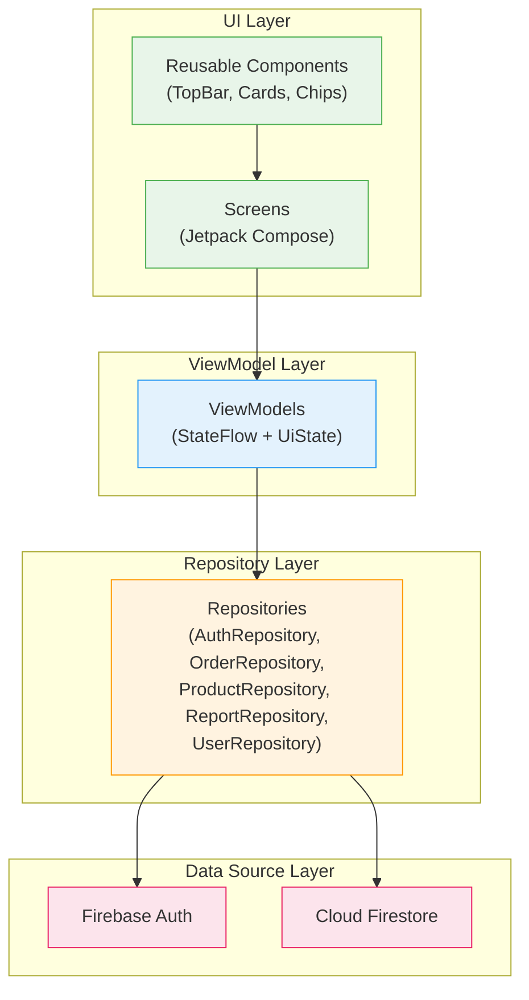
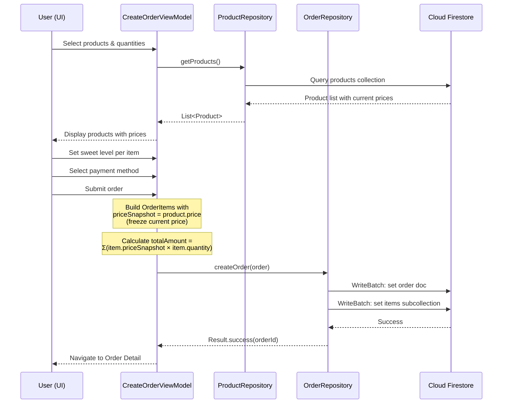
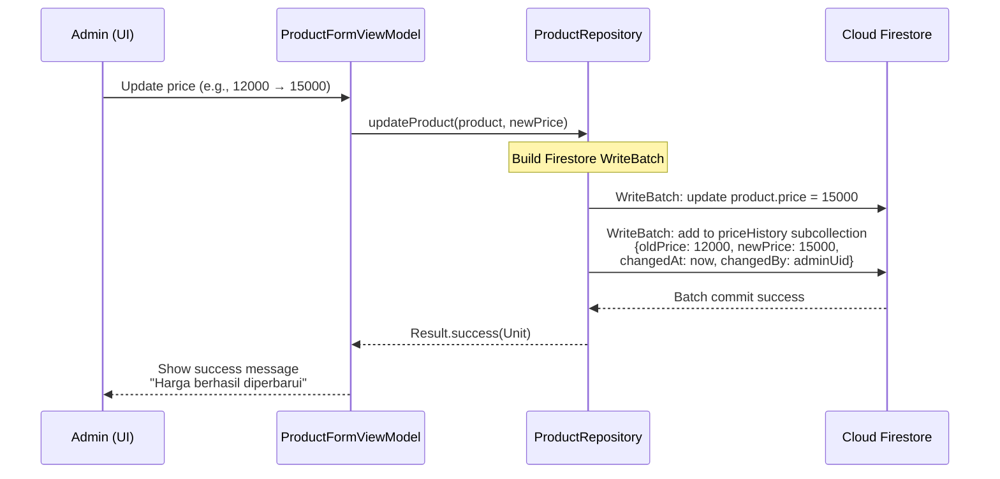
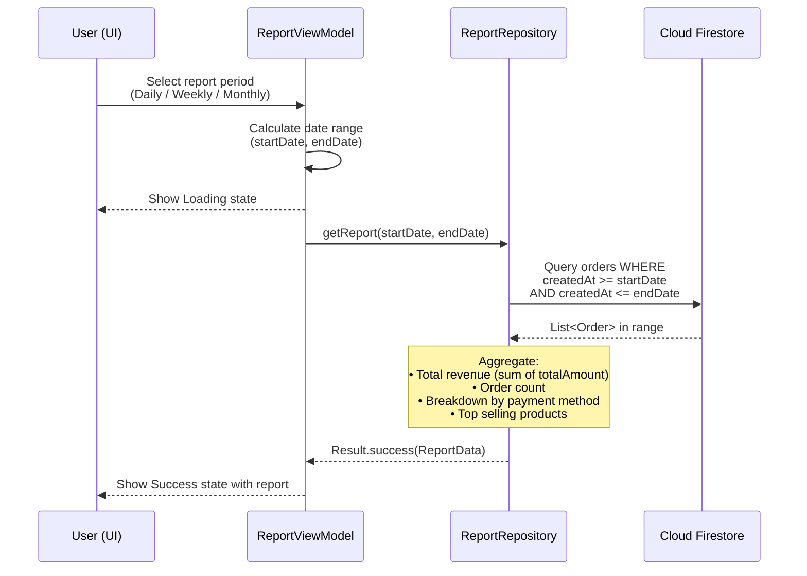
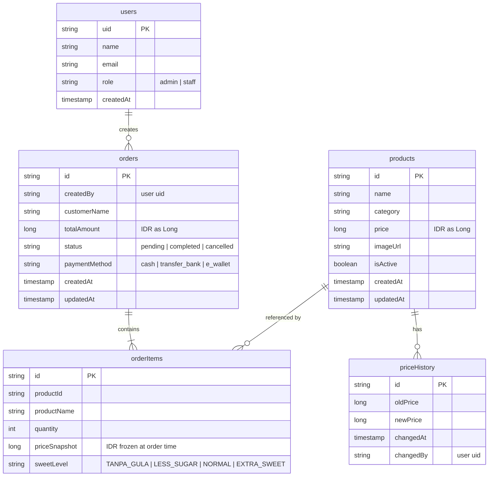
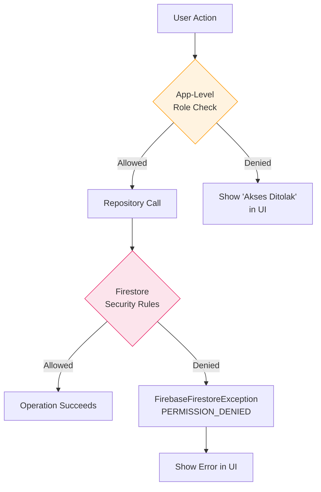

# TRD — JoyMilk: Technical Requirements Document

> **Project:** JoyMilk — Internal Soy Milk Business Order Management App  
> **Platform:** Android (Native)  
> **Package:** `com.joymilk.app`  
> **Version:** 1.0.0  
> **Last Updated:** 2026-11-10

---

## 1. Tech Stack Overview

| Layer | Technology | Version | Justification |
|---|---|---|---|
| **Language** | Kotlin | 2.1.0 | Modern, concise, null-safe language; first-class Android support |
| **UI Framework** | Jetpack Compose + Material 3 | BOM 2024.12.01 | Declarative UI toolkit; Material 3 provides modern design system with dynamic theming |
| **Navigation** | Compose Navigation | 2.8.5 | Type-safe navigation integrated with Compose lifecycle |
| **Architecture** | MVVM + Clean Architecture | — | Separation of concerns; testable and maintainable codebase |
| **Dependency Injection** | Hilt (Dagger) | 2.53.1 | Compile-time DI with Android-specific lifecycle integration |
| **Backend** | Firebase (Firestore + Auth) | BOM 33.7.0 | Real-time cloud sync, built-in auth, offline persistence; ideal for 2–5 user scale |
| **Build System** | Gradle Kotlin DSL + AGP | AGP 8.7.3 | Type-safe build scripts with IDE auto-completion |
| **Min SDK** | Android 8.0 (API 26) | — | Covers 95%+ of active devices; enables Java 8+ time APIs without desugaring |
| **Target SDK** | API 35 | — | Latest Android platform compliance |

---

## 2. System Architecture

JoyMilk follows a **Single Activity** architecture with **MVVM + Clean Architecture** layering. All navigation is handled by Jetpack Compose Navigation within a single `MainActivity`.

### Architecture Layers



### Key Architectural Decisions

- **Single Activity:** `MainActivity` hosts the entire Compose navigation graph. No Fragments are used.
- **Unidirectional Data Flow:** UI emits events → ViewModel processes → State updates → UI re-composes.
- **Hilt DI:** All ViewModels and Repositories are injected via Hilt, ensuring proper scoping and lifecycle management.
- **Price Snapshot Pattern:** Orders freeze product prices at creation time, ensuring historical accuracy regardless of future price changes.

---

## 3. Project Structure

```
d:\JoyMilk\
├── app/
│   ├── build.gradle.kts
│   ├── google-services.json
│   └── src/main/
│       ├── AndroidManifest.xml
│       ├── java/com/joymilk/app/
│       │   ├── JoyMilkApp.kt                     # @HiltAndroidApp Application class
│       │   ├── MainActivity.kt                    # Single Activity entry point
│       │   │
│       │   ├── data/
│       │   │   ├── model/
│       │   │   │   ├── User.kt                    # User data class (uid, name, email, role)
│       │   │   │   ├── Product.kt                 # Product data class (id, name, category, price, imageUrl)
│       │   │   │   ├── PriceHistory.kt            # Price history entry (oldPrice, newPrice, changedAt, changedBy)
│       │   │   │   ├── Order.kt                   # Order data class (id, items, total, status, paymentMethod)
│       │   │   │   ├── OrderItem.kt               # Order line item (productId, productName, qty, priceSnapshot, sweetLevel)
│       │   │   │   └── SweetLevel.kt              # Enum: TANPA_GULA, LESS_SUGAR, NORMAL, EXTRA_SWEET
│       │   │   │
│       │   │   └── repository/
│       │   │       ├── AuthRepository.kt           # Firebase Auth operations
│       │   │       ├── OrderRepository.kt          # Order CRUD with Firestore
│       │   │       ├── ProductRepository.kt        # Product CRUD + price history
│       │   │       ├── ReportRepository.kt         # Aggregation queries for reports
│       │   │       └── UserRepository.kt           # User profile management
│       │   │
│       │   ├── di/
│       │   │   └── AppModule.kt                    # Hilt @Module: provides Firebase instances
│       │   │
│       │   ├── ui/
│       │   │   ├── navigation/
│       │   │   │   └── NavGraph.kt                 # Compose Navigation graph definition
│       │   │   │
│       │   │   ├── theme/
│       │   │   │   ├── Color.kt                    # Material 3 color scheme
│       │   │   │   ├── Theme.kt                    # JoyMilkTheme composable
│       │   │   │   └── Type.kt                     # Typography definitions
│       │   │   │
│       │   │   ├── components/
│       │   │   │   ├── JoyMilkTopBar.kt            # Shared top app bar
│       │   │   │   ├── OrderCard.kt                # Order summary card
│       │   │   │   ├── ProductCard.kt              # Product display card
│       │   │   │   ├── StatusChip.kt               # Order status chip (color-coded)
│       │   │   │   └── LoadingIndicator.kt         # Full-screen loading overlay
│       │   │   │
│       │   │   ├── auth/
│       │   │   │   ├── LoginScreen.kt              # Login UI
│       │   │   │   └── LoginViewModel.kt           # Login state management
│       │   │   │
│       │   │   ├── dashboard/
│       │   │   │   ├── DashboardScreen.kt          # Main dashboard with summary
│       │   │   │   └── DashboardViewModel.kt       # Dashboard data aggregation
│       │   │   │
│       │   │   ├── order/
│       │   │   │   ├── OrderListScreen.kt          # List of all orders
│       │   │   │   ├── OrderDetailScreen.kt        # Single order detail view
│       │   │   │   ├── CreateOrderScreen.kt        # New order form
│       │   │   │   ├── OrderListViewModel.kt       # Order list state
│       │   │   │   ├── OrderDetailViewModel.kt     # Order detail state
│       │   │   │   └── CreateOrderViewModel.kt     # Order creation logic
│       │   │   │
│       │   │   ├── product/
│       │   │   │   ├── ProductListScreen.kt        # Product catalog
│       │   │   │   ├── ProductFormScreen.kt        # Add/edit product
│       │   │   │   ├── ProductListViewModel.kt     # Product list state
│       │   │   │   └── ProductFormViewModel.kt     # Product form logic
│       │   │   │
│       │   │   ├── report/
│       │   │   │   ├── ReportScreen.kt             # Report dashboard (daily/weekly/monthly)
│       │   │   │   └── ReportViewModel.kt          # Report computation
│       │   │   │
│       │   │   └── user/
│       │   │       ├── UserManagementScreen.kt     # Admin user management
│       │   │       └── UserManagementViewModel.kt  # User CRUD state
│       │   │
│       │   └── util/
│       │       ├── DateUtils.kt                    # Date formatting & range helpers
│       │       ├── CurrencyUtils.kt                # IDR formatting (Long → "Rp 15.000")
│       │       └── Constants.kt                    # App-wide constants
│       │
│       └── res/
│           ├── values/strings.xml                  # Bahasa Indonesia strings
│           └── ...
│
├── build.gradle.kts                                # Project-level build script
├── settings.gradle.kts                             # Project settings
├── gradle/
│   └── libs.versions.toml                          # Version catalog
├── docs/
│   └── TRD.md                                      # This document
└── ...
```

---

## 4. Data Flow

### 4.1 Create Order Flow (with Price Snapshot)

When a user creates a new order, the current product prices are **snapshotted** into each `OrderItem`. This ensures that future price changes do not affect historical order data.



### 4.2 Update Product Price Flow (with Auto Price History)

When an admin updates a product price, the system automatically records the old and new price in the `priceHistory` subcollection.



### 4.3 Report Generation Flow

Reports aggregate order data by date range (daily, weekly, or monthly).



---

## 5. State Management

### Pattern: StateFlow + Sealed UiState

All ViewModels expose state via `StateFlow` (never `LiveData`). The `UiState` sealed class provides a consistent pattern across all screens.

```kotlin
// Generic UiState pattern used across all features
sealed class UiState<out T> {
    data object Loading : UiState<Nothing>()
    data class Success<T>(val data: T) : UiState<T>()
    data class Error(val message: String) : UiState<Nothing>()
}

// Example: OrderListViewModel
@HiltViewModel
class OrderListViewModel @Inject constructor(
    private val orderRepository: OrderRepository
) : ViewModel() {

    private val _uiState = MutableStateFlow<UiState<List<Order>>>(UiState.Loading)
    val uiState: StateFlow<UiState<List<Order>>> = _uiState.asStateFlow()

    init {
        loadOrders()
    }

    fun loadOrders() {
        viewModelScope.launch {
            _uiState.value = UiState.Loading
            orderRepository.getOrders()
                .onSuccess { orders ->
                    _uiState.value = UiState.Success(orders)
                }
                .onFailure { exception ->
                    _uiState.value = UiState.Error(
                        exception.message ?: "Gagal memuat pesanan"
                    )
                }
        }
    }
}
```

### Collecting State in Compose

```kotlin
@Composable
fun OrderListScreen(viewModel: OrderListViewModel = hiltViewModel()) {
    val uiState by viewModel.uiState.collectAsStateWithLifecycle()

    when (val state = uiState) {
        is UiState.Loading -> LoadingIndicator()
        is UiState.Success -> OrderList(orders = state.data)
        is UiState.Error -> ErrorMessage(
            message = state.message,
            onRetry = { viewModel.loadOrders() }
        )
    }
}
```

---

## 6. Dependencies

### `gradle/libs.versions.toml`

```toml
[versions]
# Core
agp = "8.7.3"
kotlin = "2.1.0"

# Compose
composeBom = "2024.12.01"
composeNavigation = "2.8.5"
activityCompose = "1.9.3"
lifecycleRuntimeCompose = "2.8.7"

# Hilt
hilt = "2.53.1"
hiltNavigationCompose = "1.2.0"

# Firebase
firebaseBom = "33.7.0"

# KSP
ksp = "2.1.0-1.0.29"

# Testing
junit = "4.13.2"
junitExt = "1.2.1"
espresso = "3.6.1"

# Other
coreKtx = "1.15.0"
coroutines = "1.9.0"
material3 = "1.3.1"

[libraries]
# AndroidX Core
androidx-core-ktx = { group = "androidx.core", name = "core-ktx", version.ref = "coreKtx" }
androidx-activity-compose = { group = "androidx.activity", name = "activity-compose", version.ref = "activityCompose" }

# Compose BOM
compose-bom = { group = "androidx.compose", name = "compose-bom", version.ref = "composeBom" }
compose-ui = { group = "androidx.compose.ui", name = "ui" }
compose-ui-graphics = { group = "androidx.compose.ui", name = "ui-graphics" }
compose-ui-tooling-preview = { group = "androidx.compose.ui", name = "ui-tooling-preview" }
compose-ui-tooling = { group = "androidx.compose.ui", name = "ui-tooling" }
compose-ui-test-manifest = { group = "androidx.compose.ui", name = "ui-test-manifest" }
compose-ui-test-junit4 = { group = "androidx.compose.ui", name = "ui-test-junit4" }
compose-material3 = { group = "androidx.compose.material3", name = "material3", version.ref = "material3" }
compose-material-icons-extended = { group = "androidx.compose.material", name = "material-icons-extended" }

# Navigation
compose-navigation = { group = "androidx.navigation", name = "navigation-compose", version.ref = "composeNavigation" }

# Lifecycle
lifecycle-runtime-compose = { group = "androidx.lifecycle", name = "lifecycle-runtime-compose", version.ref = "lifecycleRuntimeCompose" }
lifecycle-viewmodel-compose = { group = "androidx.lifecycle", name = "lifecycle-viewmodel-compose", version.ref = "lifecycleRuntimeCompose" }

# Hilt
hilt-android = { group = "com.google.dagger", name = "hilt-android", version.ref = "hilt" }
hilt-compiler = { group = "com.google.dagger", name = "hilt-compiler", version.ref = "hilt" }
hilt-navigation-compose = { group = "androidx.hilt", name = "hilt-navigation-compose", version.ref = "hiltNavigationCompose" }

# Firebase BOM
firebase-bom = { group = "com.google.firebase", name = "firebase-bom", version.ref = "firebaseBom" }
firebase-auth-ktx = { group = "com.google.firebase", name = "firebase-auth-ktx" }
firebase-firestore-ktx = { group = "com.google.firebase", name = "firebase-firestore-ktx" }

# Coroutines
kotlinx-coroutines-android = { group = "org.jetbrains.kotlinx", name = "kotlinx-coroutines-android", version.ref = "coroutines" }
kotlinx-coroutines-play-services = { group = "org.jetbrains.kotlinx", name = "kotlinx-coroutines-play-services", version.ref = "coroutines" }

# Testing
junit = { group = "junit", name = "junit", version.ref = "junit" }
androidx-junit = { group = "androidx.test.ext", name = "junit", version.ref = "junitExt" }
androidx-espresso-core = { group = "androidx.test.espresso", name = "espresso-core", version.ref = "espresso" }

[plugins]
android-application = { id = "com.android.application", version.ref = "agp" }
kotlin-android = { id = "org.jetbrains.kotlin.android", version.ref = "kotlin" }
kotlin-compose = { id = "org.jetbrains.kotlin.plugin.compose", version.ref = "kotlin" }
hilt-android = { id = "com.google.dagger.hilt.android", version.ref = "hilt" }
google-services = { id = "com.google.gms.google-services", version = "4.4.2" }
ksp = { id = "com.google.devtools.ksp", version.ref = "ksp" }
```

---

## 7. Firebase Configuration

### 7.1 Firestore Offline Persistence

Firestore offline persistence is **enabled by default** on Android. No additional configuration is needed. Data is cached locally and synced when connectivity is restored — ideal for the 2–5 user scale of JoyMilk.

### 7.2 Firestore Data Model



### 7.3 Security Rules

```javascript
rules_version = '2';
service cloud.firestore {
  match /databases/{database}/documents {

    // Helper: Check if the requesting user is authenticated
    function isAuthenticated() {
      return request.auth != null;
    }

    // Helper: Get the user's role from the users collection
    function getUserRole() {
      return get(/databases/$(database)/documents/users/$(request.auth.uid)).data.role;
    }

    // Helper: Check if user is admin
    function isAdmin() {
      return isAuthenticated() && getUserRole() == 'admin';
    }

    // Helper: Check if user is staff or admin
    function isStaffOrAdmin() {
      return isAuthenticated() && getUserRole() in ['admin', 'staff'];
    }

    // Users collection: admin can CRUD, users can read own profile
    match /users/{userId} {
      allow read: if isAuthenticated() && (request.auth.uid == userId || isAdmin());
      allow create, update, delete: if isAdmin();
    }

    // Products collection: anyone authenticated can read, admin can write
    match /products/{productId} {
      allow read: if isAuthenticated();
      allow create, update, delete: if isAdmin();

      // Price history subcollection
      match /priceHistory/{historyId} {
        allow read: if isAuthenticated();
        allow create: if isAdmin();
        allow update, delete: if false; // Price history is immutable
      }
    }

    // Orders collection: staff/admin can CRUD
    match /orders/{orderId} {
      allow read: if isStaffOrAdmin();
      allow create: if isStaffOrAdmin();
      allow update: if isStaffOrAdmin();
      allow delete: if isAdmin();

      // Order items subcollection
      match /items/{itemId} {
        allow read: if isStaffOrAdmin();
        allow create: if isStaffOrAdmin();
        allow update, delete: if isAdmin();
      }
    }
  }
}
```

### 7.4 Composite Indexes

The following Firestore composite indexes are required:

| Collection | Fields | Query Purpose |
|---|---|---|
| `orders` | `createdAt` ASC + `status` ASC | Filter orders by date range and status |
| `orders` | `createdBy` ASC + `createdAt` DESC | User's orders sorted by newest first |
| `orders` | `paymentMethod` ASC + `createdAt` DESC | Filter by payment method |
| `products` | `category` ASC + `name` ASC | Product listing grouped by category |
| `products` | `isActive` ASC + `category` ASC | Active products by category |

---

## 8. Error Handling Strategy

### 8.1 Repository Layer — `Result<T>` Pattern

All repository methods return `Result<T>` to encapsulate success and failure states. Exceptions are caught at the repository boundary and never propagated to the ViewModel.

```kotlin
class OrderRepository @Inject constructor(
    private val firestore: FirebaseFirestore
) {
    suspend fun getOrders(): Result<List<Order>> {
        return try {
            val snapshot = firestore.collection("orders")
                .orderBy("createdAt", Query.Direction.DESCENDING)
                .get()
                .await()

            val orders = snapshot.documents.mapNotNull { doc ->
                doc.toObject(Order::class.java)?.copy(id = doc.id)
            }
            Result.success(orders)
        } catch (e: FirebaseFirestoreException) {
            Result.failure(e)
        } catch (e: Exception) {
            Result.failure(e)
        }
    }
}
```

### 8.2 ViewModel Layer — Mapping to UiState

```kotlin
viewModelScope.launch {
    _uiState.value = UiState.Loading
    repository.getOrders()
        .onSuccess { _uiState.value = UiState.Success(it) }
        .onFailure { _uiState.value = UiState.Error(mapErrorMessage(it)) }
}

private fun mapErrorMessage(throwable: Throwable): String {
    return when (throwable) {
        is FirebaseFirestoreException -> "Gagal terhubung ke server. Periksa koneksi internet Anda."
        is FirebaseAuthException -> "Sesi login telah berakhir. Silakan login kembali."
        else -> "Terjadi kesalahan. Silakan coba lagi."
    }
}
```

### 8.3 UI Layer — Error Display

All error messages are displayed in **Bahasa Indonesia** to end users. Technical details are logged but not shown.

```kotlin
@Composable
fun ErrorMessage(message: String, onRetry: () -> Unit) {
    Column(
        modifier = Modifier.fillMaxSize(),
        horizontalAlignment = Alignment.CenterHorizontally,
        verticalArrangement = Arrangement.Center
    ) {
        Icon(Icons.Default.ErrorOutline, contentDescription = null, tint = MaterialTheme.colorScheme.error)
        Spacer(modifier = Modifier.height(16.dp))
        Text(text = message, style = MaterialTheme.typography.bodyLarge)
        Spacer(modifier = Modifier.height(8.dp))
        Button(onClick = onRetry) {
            Text("Coba Lagi")
        }
    }
}
```

---

## 9. Performance Considerations

### 9.1 Firestore Query Pagination

For large order lists, implement cursor-based pagination using Firestore's `startAfter()`:

```kotlin
suspend fun getOrdersPaginated(
    lastDocument: DocumentSnapshot? = null,
    pageSize: Int = 20
): Result<Pair<List<Order>, DocumentSnapshot?>> {
    return try {
        var query = firestore.collection("orders")
            .orderBy("createdAt", Query.Direction.DESCENDING)
            .limit(pageSize.toLong())

        if (lastDocument != null) {
            query = query.startAfter(lastDocument)
        }

        val snapshot = query.get().await()
        val orders = snapshot.documents.mapNotNull { it.toObject(Order::class.java) }
        val lastDoc = snapshot.documents.lastOrNull()

        Result.success(orders to lastDoc)
    } catch (e: Exception) {
        Result.failure(e)
    }
}
```

### 9.2 Offline-First Architecture

- Firestore SDK caches all read data locally by default.
- Writes are queued when offline and synced automatically when connectivity resumes.
- For the 2–5 user scale, conflict resolution is minimal — Firestore's last-write-wins is sufficient.

### 9.3 Compose Performance

| Technique | Implementation |
|---|---|
| **Lazy Lists** | Use `LazyColumn` / `LazyRow` for all scrollable lists |
| **Stable Keys** | Provide `key = { item.id }` in `LazyColumn` items |
| **Derived State** | Use `derivedStateOf` for computed values from state |
| **Immutable Models** | All data classes use `val` properties (immutable by default) |
| **Recomposition Scope** | Keep composable functions granular to minimize recomposition scope |

---

## 10. Security

### 10.1 Authentication

- **Firebase Authentication** with email/password sign-in method.
- Session tokens are managed by the Firebase SDK automatically.
- Token refresh is handled transparently.

### 10.2 Authorization — Defense in Depth

Authorization is enforced at **two layers**:



1. **App-level (client):** Navigation and UI elements are conditionally rendered based on user role. Admin-only screens (Product CRUD, User Management) check the role before navigating.
2. **Firestore Security Rules (server):** Even if client-side checks are bypassed, Firestore rules enforce role-based access at the database level.

### 10.3 Data Security Practices

| Practice | Implementation |
|---|---|
| No sensitive data in logs | Use `Log.d()` only in debug builds; strip via ProGuard in release |
| No hardcoded secrets | Firebase config via `google-services.json` (gitignored) |
| Secure network | All Firebase communication is over TLS by default |
| Input validation | Validate all user inputs before Firestore writes |
| Money as Long | IDR stored as `Long` — no floating point precision issues |

---

## 11. Build & Deployment

### 11.1 Debug Build

```bash
./gradlew assembleDebug
```

The APK is output to `app/build/outputs/apk/debug/app-debug.apk`.

### 11.2 Release Build

#### Signing Configuration

Add to `app/build.gradle.kts`:

```kotlin
android {
    signingConfigs {
        create("release") {
            storeFile = file(project.property("RELEASE_STORE_FILE") as String)
            storePassword = project.property("RELEASE_STORE_PASSWORD") as String
            keyAlias = project.property("RELEASE_KEY_ALIAS") as String
            keyPassword = project.property("RELEASE_KEY_PASSWORD") as String
        }
    }

    buildTypes {
        release {
            isMinifyEnabled = true
            isShrinkResources = true
            proguardFiles(
                getDefaultProguardFile("proguard-android-optimize.txt"),
                "proguard-rules.pro"
            )
            signingConfig = signingConfigs.getByName("release")
        }
    }
}
```

Store signing credentials in `local.properties` (gitignored):

```properties
RELEASE_STORE_FILE=../keystore/joymilk-release.jks
RELEASE_STORE_PASSWORD=********
RELEASE_KEY_ALIAS=joymilk
RELEASE_KEY_PASSWORD=********
```

#### Build Command

```bash
./gradlew assembleRelease
```

### 11.3 ProGuard / R8 Rules

Add to `proguard-rules.pro`:

```proguard
# Firebase Firestore model classes
-keepclassmembers class com.joymilk.app.data.model.** {
    *;
}

# Keep Firestore annotation
-keepattributes *Annotation*

# Kotlin coroutines
-keepnames class kotlinx.coroutines.internal.MainDispatcherFactory {}
-keepnames class kotlinx.coroutines.CoroutineExceptionHandler {}

# Hilt
-keep class dagger.hilt.** { *; }
-keep class javax.inject.** { *; }
-keep class * extends dagger.hilt.android.lifecycle.HiltViewModel { *; }
```

### 11.4 Build Variants Summary

| Variant | Minify | Shrink Resources | Signing | Use Case |
|---|---|---|---|---|
| `debug` | ❌ | ❌ | Debug keystore | Development & testing |
| `release` | ✅ (R8) | ✅ | Release keystore | Production distribution |

---

> **Document maintained by:** JoyMilk Development Team  
> **Next review:** Upon major architecture change or dependency update
