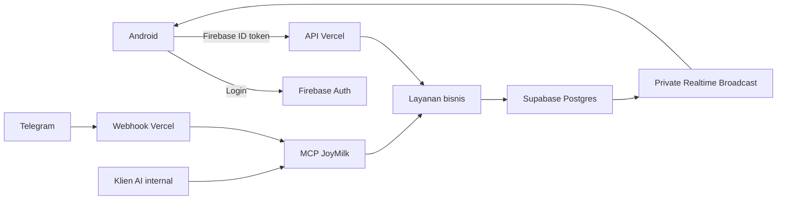

# TRD — Arsitektur JoyMilk

Ini adalah arsitektur yang diterapkan dalam repository. Referensi status aplikasi dan urutan rollout ada di [rencana implementasi](IMPLEMENTATION_PLAN.md).

## Komponen

| Komponen | Tanggung jawab |
|---|---|
| Android | Kotlin, Compose Material 3, Navigation, Hilt, MVVM, dan `StateFlow`. Firebase Auth untuk login email/password. Repository memakai JSON API lewat OkHttp. WebSocket Supabase Realtime memberi sinyal perubahan. |
| Vercel | Next.js Route Handlers dengan runtime Node.js dan TypeScript. Jalankan API Android, endpoint MCP, dan webhook Telegram dalam satu layanan. |
| Supabase | Postgres untuk data bisnis. Backend memakai koneksi pooled dan role runtime khusus. Realtime Broadcast terbatas pada topik privat. |

Android mengirim `Authorization: Bearer <Firebase ID token>` ke API. Firebase Admin memverifikasi tanda tangan, proyek, masa berlaku, dan pencabutan token. Backend memakai UID token untuk memeriksa profil aktif serta peran pada setiap permintaan. Firebase Auth juga tetap menjadi sumber akun dan kata sandi. Pembuatan pengguna oleh admin harus dapat dipulihkan bila pembuatan profil gagal setelah akun Firebase dibuat. Gunakan UID akun yang baru dibuat untuk menyelesaikan percobaan ulang atau hapus akun tersebut melalui tindakan kompensasi.

Supabase Realtime memakai integrasi Firebase Auth pihak ketiga dan custom claim `role: authenticated`; peran bisnis tetap disimpan di Supabase. Kebijakan Realtime memeriksa Firebase UID dan profil aktif untuk topik privat. Trigger memasukkan event privat dalam transaksi penulisan sehingga subscriber hanya melihat perubahan setelah commit. Payload hanya berisi jenis perubahan. Android memuat ulang lewat API setelah event atau reconnect. Cabut grant akses tabel bisnis dari klien dan simpan kredensial backend di environment Vercel. [Firebase Admin SDK](https://firebase.google.com/docs/auth/admin/verify-id-tokens) · [Integrasi Firebase Auth](https://supabase.com/docs/guides/auth/third-party/firebase-auth) · [Supabase Broadcast](https://supabase.com/docs/guides/realtime/broadcast)

## Alur data



Repository Android mengembalikan `Result<T>`. ViewModel mengekspos `StateFlow` dengan state loading, hasil, dan error. Composable membaca state melalui `collectAsStateWithLifecycle()`. Data form disimpan terpisah dari status pengiriman agar kegagalan tidak menghapus input. Pertahankan lazy list dengan key ID stabil.

## HTTP API Android

Prefix `/api/v1`. JSON menggunakan camelCase dan waktu ISO 8601 UTC. Nilai uang diterima Android sebagai Kotlin `Long`. Kirim nominal sebagai string desimal JSON untuk menghindari kehilangan presisi pada runtime JavaScript. Android memvalidasi dan mengonversinya ke `Long`. Gunakan agregasi Postgres untuk laporan.

| Operasi | Route |
|---|---|
| Profil pengguna saat ini | `GET /me` |
| Produk dan riwayat harga | `GET /products`, `POST /products`, `PATCH /products/{id}`, `GET /products/{id}/price-history` |
| Kategori | `GET /categories`, `POST /categories` |
| Order | `GET /orders`, `GET /orders/{id}`, `POST /orders`, `PATCH /orders/{id}`, `PATCH /orders/{id}/status` |
| Pengguna | `GET /users`, `POST /users`, `PATCH /users/{uid}` |
| Ringkasan penjualan | `GET /reports?from=YYYY-MM-DD&to=YYYY-MM-DD` |

Contoh `POST /api/v1/orders` dengan header `Idempotency-Key`.

```json
{
  "customerName": "Rina",
  "paymentMethod": "tunai",
  "items": [
    {
      "productId": "a4914e54-2638-48d9-9a60-2dbdff423e13",
      "quantity": 2,
      "sweetLevel": "NORMAL"
    }
  ]
}
```

Bidang opsional adalah `customerPhone`, `deliveryAddress`, dan `notes`. Backend menetapkan aktor, waktu, status, harga, serta nominal. Kesuksesan mengembalikan objek order beserta ID, status, snapshot item, dan total. Untuk edit dan perubahan status, kirim `updatedAt` versi yang dibaca agar backend dapat menolak update usang. Gunakan `401` untuk autentikasi gagal, `403` untuk akses ditolak, `404` untuk entitas yang tidak ditemukan, `409` untuk konflik, dan `422` untuk validasi input. Error JSON memuat `code`, `message`, dan bila diperlukan `field`.

## Telegram dan MCP

`POST /api/telegram/webhook` memverifikasi `X-Telegram-Bot-Api-Secret-Token` dan memproses `message` serta `callback_query` dari chat privat. Resolusi identitas memakai ID pengirim dari update Telegram. Ringkasan draf memuat pelanggan, detail pengiriman yang diisi, item, kuantitas, tingkat kemanisan, metode pembayaran, harga, dan total. Interpretasi bahasa alami memakai OpenAI dengan keluaran JSON terstruktur, dengan model yang ditetapkan saat deployment. Isi chat dikirim untuk ekstraksi draf. Model tidak memiliki akses ke fungsi penyimpanan. Gunakan pencarian katalog untuk ID produk dan tanyakan detail yang hilang atau ambigu. Panggilan konfirmasi bot dilakukan oleh handler callback setelah validasi pemilik draf.

`/api/mcp` memakai Streamable HTTP dan memvalidasi `Origin` ketika header itu dikirim. Gunakan bearer token internal per klien yang bisa dicabut, terikat ke profil aktif, dan dibatasi per tool. Webhook memakai server MCP dan transport dalam proses yang sama. Identitas Telegram hanya berasal dari webhook terverifikasi dan tidak diterima sebagai argumen tool MCP publik. Server memetakan identitas tersebut ke Firebase UID. Tool untuk klien AI mengambil aktor dari token.

| Tool | Input dan hasil |
|---|---|
| `search_products` | Cari produk aktif berdasarkan `query`. Kembalikan ID, nama, ukuran, unit, dan harga. |
| `prepare_order` | Terima formulir yang sama dengan API order. Kembalikan `draftId`, `revision`, waktu kedaluwarsa, dan ringkasan harga, atau detail validasi. |
| `confirm_order` | Terima `draftId` dan `revision` yang ditinjau. Kembalikan order yang tersimpan. Draf kedaluwarsa perlu dibuat ulang. Perubahan harga atau nama menerbitkan revisi baru dan mengembalikan ringkasannya. Permintaan dengan revisi usang tidak dapat menyimpan order. |

Klien AI meminta persetujuan pengguna sebelum memanggil `confirm_order`. Token dengan izin tersebut memungkinkan klien memicu penulisan, sehingga hanya diberikan kepada klien internal yang dipercaya menjalankan konfirmasi. Simpan hash token klien dan periksa pencabutan pada setiap panggilan. [Telegram Bot API](https://core.telegram.org/bots/api) · [MCP Streamable HTTP](https://modelcontextprotocol.io/specification/2025-11-25/basic/transports) · [MCP di Vercel](https://vercel.com/docs/mcp/deploy-mcp-servers-to-vercel)

## Operasional

Pisahkan konfigurasi staging dan produksi untuk URL API, proyek Firebase, Supabase, dan bot Telegram. Simpan kredensial Firebase Admin, URL koneksi database, token bot, secret webhook, serta API key interpretasi chat di Vercel. Log request ID, kanal, hasil, dan kode error. Keluarkan isi pesan, detail pelanggan, kata sandi, token, dan kredensial dari log. Pantau kegagalan transaksi, konflik idempotensi, penolakan webhook, dan error Realtime.

Lihat [skema dan transaksi](DATABASE_SCHEMA.md) serta [alur pengguna dan pemulihan](WORKFLOW.md).
