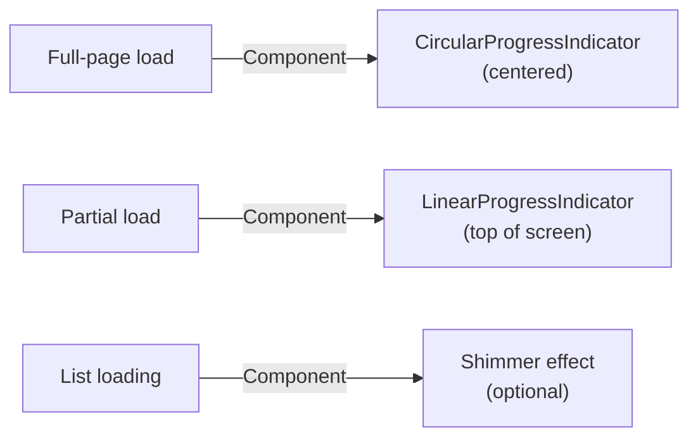
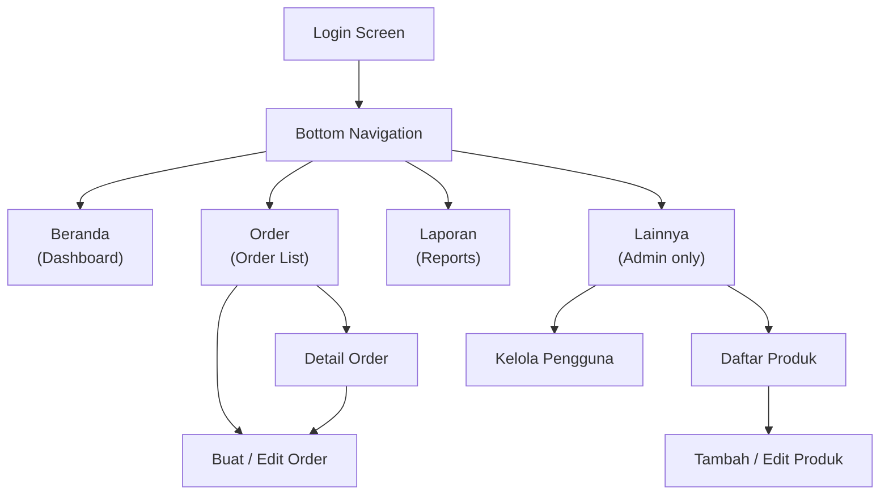

# UI/UX Rules — JoyMilk Android App

> Panduan desain dan tata letak untuk aplikasi Android JoyMilk.
> Framework: Jetpack Compose · Material 3 (Material You) · Kotlin

---

## 1. Design System

### 1.1 Framework

| Aspect | Choice |
|---|---|
| UI Toolkit | Jetpack Compose |
| Design System | Material 3 (Material You) |
| Dynamic Color | **Disabled** — fixed brand colors for visual consistency |

### 1.2 Color Palette

#### Brand Colors (Natural Soy Milk Theme)

| Token | Hex | Usage |
|---|---|---|
| **Primary** | `#4CAF50` 🟢 | Green — fresh, natural feel |
| Primary Container | `#C8E6C9` | Lighter green for containers/surfaces |
| **Secondary** | `#FFF8E1` 🟡 | Cream — soy milk color |
| Secondary Container | `#FFE082` | Amber tint for secondary containers |
| **Tertiary** | `#795548` 🟤 | Brown — soybean/earth tone accent |
| Background | `#FAFAFA` | App background |
| Surface | `#FFFFFF` | Card and sheet surfaces |
| Error | `#D32F2F` | Error states, destructive actions |
| On Primary | `#FFFFFF` | Text/icons on primary color |
| On Secondary | `#1B1B1B` | Text/icons on secondary color |
| On Background | `#1B1B1B` | Main content text |

#### Order Status Colors

| Status | Hex | Style |
|---|---|---|
| **Pending** | `#FF9800` (Orange) | Orange background, dark text |
| **Processing** | `#2196F3` (Blue) | Blue background, white text |
| **Delivered** | `#4CAF50` (Green) | Green background, white text |
| **Cancelled** | `#9E9E9E` (Grey) | Grey background, dark text |

### 1.3 Typography

Use the **Material 3 default typography scale**. Role mapping:

| Typography Role | UI Usage |
|---|---|
| Display | Product name in cards |
| Headline | Screen titles |
| Title | Section headers, card titles |
| Body | Content text, form labels |
| Label | Chips, badges, small text |

### 1.4 Spacing & Layout

```
Standard padding ......... 16dp
Card padding .............. 12dp
Item spacing (lists) ...... 8dp
Screen edge padding ....... 16dp
FAB bottom padding ........ 16dp from bottom edge
Bottom nav bar height ..... 80dp
```

### 1.5 Icons

- Icon set: **Material Icons Extended**
- **Filled** style → selected / active states
- **Outlined** style → unselected states

| Function | Icon |
|---|---|
| Dashboard | `Icons.Filled.Dashboard` |
| Orders | `Icons.Filled.Receipt` |
| Products | `Icons.Filled.Inventory` |
| Reports | `Icons.Filled.BarChart` |
| Users | `Icons.Filled.People` |
| Add | `Icons.Filled.Add` |
| Search | `Icons.Filled.Search` |
| Filter | `Icons.Filled.FilterList` |

---

## 2. Component Specifications

### 2.1 Top App Bar

| Variant | When to Use |
|---|---|
| `SmallTopAppBar` | Most screens |
| `LargeTopAppBar` | Dashboard only |

Rules:
- Always show screen title in **Bahasa Indonesia**
- Show back arrow (`←`) on detail / form screens
- Action buttons (filter, search, etc.) aligned to the **right**

### 2.2 Cards (OrderCard, ProductCard)

```
Elevation ............. 2dp
Corner radius ......... 12dp
Content padding ....... 12dp
```

**OrderCard** displays:
- Customer name
- Date
- Total (Rp formatted)
- Status chip
- Item count

**ProductCard** displays:
- Product name
- Category
- Price (Rp formatted)
- Unit
- Active / Inactive badge

### 2.3 Status Chip

Use `AssistChip` style with colored background:

| Status | Background | Text Color |
|---|---|---|
| Pending | Orange (`#FF9800`) | Dark |
| Processing | Blue (`#2196F3`) | White |
| Delivered | Green (`#4CAF50`) | White |
| Cancelled | Grey (`#9E9E9E`) | Dark |

### 2.4 Sweet Level Selector

- Component: `SegmentedButton` or `FilterChip` row
- Options: **Tanpa Gula** · **Less Sugar** · **Normal** · **Extra Sweet**
- Default selection: `Normal`
- Enable horizontal scroll when space is constrained

> [!NOTE]
> Sweet level is a preference only — it has **no impact on price**.

### 2.5 Forms

| Element | Specification |
|---|---|
| Text input | `OutlinedTextField` |
| Labels | Bahasa Indonesia |
| Error text | Below field, in red (`#D32F2F`) |
| Required fields | Marked with `*` in label |
| Dropdowns | Product selection, payment method, sweet level, unit, category |
| Numeric input | Number keyboard type for quantity and price fields |

### 2.6 Bottom Navigation

Bottom Navigation Bar with role-based visibility:

| Tab | Label (ID) | Icon | Admin | Staff |
|---|---|---|---|---|
| Dashboard | Beranda | `Dashboard` | ✅ | ✅ |
| Orders | Order | `Receipt` | ✅ | ✅ |
| Reports | Laporan | `BarChart` | ✅ | ✅ |
| More | Lainnya | `MoreHoriz` | ✅ | ❌ |

> The **Lainnya** tab leads to Products and Users management (admin only).

### 2.7 FAB (Floating Action Button)

| Screen | FAB Type | Label | Visibility |
|---|---|---|---|
| Order List | Extended FAB | "Buat Order" | All roles |
| Product List | Standard FAB | "+" | Admin only |

Position: **Bottom right**, 16dp from edges.

### 2.8 Dialogs

| Dialog Type | Usage |
|---|---|
| `AlertDialog` | Confirmations (delete, cancel order) |
| `BottomSheet` | Filters |
| Full-screen dialog | Complex forms (order form) |

### 2.9 Loading States



### 2.10 Empty States

- Centered layout: **icon + text message**
- Example message: *"Belum ada order hari ini"*
- Include a relevant illustration or icon

### 2.11 Error States

| Error Type | UI Treatment |
|---|---|
| Transient (network timeout) | `Snackbar` with dismiss action |
| Form validation | Inline error text below the field |
| Critical failure | Full-screen error with **"Coba Lagi"** retry button |

---

## 3. Screen Layouts

### 3.1 Login Screen

```
┌──────────────────────────┐
│                          │
│       🥛 JoyMilk         │
│       Logo / Title       │
│                          │
│  ┌────────────────────┐  │
│  │ Email              │  │
│  └────────────────────┘  │
│  ┌────────────────────┐  │
│  │ Password     👁    │  │
│  └────────────────────┘  │
│                          │
│  ┌────────────────────┐  │
│  │      Masuk         │  │ ← Filled, full-width
│  └────────────────────┘  │
│                          │
└──────────────────────────┘
```

- Centered layout
- Password field with show/hide toggle
- Loading indicator on button when authenticating

### 3.2 Dashboard Screen

```
┌──────────────────────────┐
│ ≡  Halo, {userName}!     │ ← LargeTopAppBar
├──────────────────────────┤
│ ┌──────────┐┌──────────┐ │
│ │Total Order││Penjualan │ │ ← Summary cards (row of 2)
│ │ Hari Ini  ││ Hari Ini │ │
│ │    12     ││Rp 240.000│ │
│ └──────────┘└──────────┘ │
│                          │
│ [   Buat Order Baru    ] │ ← Prominent quick action
│                          │
│ ── Order Terbaru ─────── │
│ │ OrderCard 1          │ │
│ │ OrderCard 2          │ │ ← Last 5 orders
│ │ OrderCard 3          │ │
│ │ ...                  │ │
└──────────────────────────┘
```

### 3.3 Order List Screen

```
┌──────────────────────────┐
│ ← Order          🔍 🔽   │ ← SmallTopAppBar
├──────────────────────────┤
│ [Hari Ini][Minggu][Bulan]│ ← Date filter chips
│ [Semua][Pending][Proc]...│ ← Status filter chips
├──────────────────────────┤
│ │ OrderCard             ││
│ │ OrderCard             ││ ← LazyColumn
│ │ OrderCard             ││    Pull-to-refresh
│ │ ...                   ││
│                          │
│              [Buat Order]│ ← Extended FAB
└──────────────────────────┘
```

### 3.4 Order Form Screen

```
┌──────────────────────────┐
│ ← Buat Order Baru        │ ← or "Edit Order"
├──────────────────────────┤
│ ── Pelanggan ──────────  │
│  Nama Pelanggan *        │
│  No. Telepon             │
│  Alamat                  │
│                          │
│ ── Produk ─────────────  │
│  ┌────────────────────┐  │
│  │ [Product ▼] [Sweet]│  │
│  │ Qty: [-] 2 [+]     │  │
│  │ Harga: Rp 10.000   │  │
│  │ Subtotal: Rp 20.000│  │
│  │              [🗑]  │  │
│  └────────────────────┘  │
│  [ + Tambah Produk ]     │
│                          │
│ ── Pembayaran ─────────  │
│  [Payment method ▼]      │
│                          │
│ ── Catatan ────────────  │
│  [optional notes field]  │
│                          │
├──────────────────────────┤
│ Total: Rp 20.000 [Simpan]│ ← Sticky bottom bar
└──────────────────────────┘
```

> [!IMPORTANT]
> Price is **frozen at order creation** (price snapshot pattern). The auto-filled price must come from the current product price at the time of order creation, and must not change if the product price is later updated.

### 3.5 Order Detail Screen

```
┌──────────────────────────┐
│ ← Order #ORD-001         │
├──────────────────────────┤
│ ── Info Pelanggan ─────  │
│  Nama: Budi              │
│  Telp: 081234567890      │
│  Alamat: Jl. Merdeka 10  │
│                          │
│ ── Item Pesanan ───────  │
│  1. Susu Kedelai Original│
│     Normal · 2x · Rp10rb │
│     Subtotal: Rp 20.000  │
│                          │
│ ── Pembayaran ─────────  │
│  Metode: Cash             │
│  Catatan: -               │
│                          │
│ ┌────────────────────┐   │
│ │  Total: Rp 20.000  │   │ ← Prominent total
│ └────────────────────┘   │
│                          │
│ [Pending 🟠] [Update ▼]  │ ← Status chip + update
│ [✏ Edit]                 │ ← Only if status = Pending
└──────────────────────────┘
```

### 3.6 Product List Screen (Admin Only)

```
┌──────────────────────────┐
│ ← Produk            🔍   │
├──────────────────────────┤
│ [Semua][Susu][Snack]...  │ ← Category filter chips
├──────────────────────────┤
│ │ ProductCard           ││
│ │ ProductCard           ││ ← LazyColumn
│ │ ProductCard           ││
│                          │
│                     [ + ]│ ← Standard FAB (admin)
└──────────────────────────┘
```

### 3.7 Product Form Screen (Admin Only)

Fields:
- **Nama Produk** * — `OutlinedTextField`
- **Kategori** * — Dropdown
- **Harga** * — Number input (IDR as `Long`)
- **Satuan** * — Dropdown (e.g., Botol, Gelas, Pack)
- **Deskripsi** — Optional text area

> [!WARNING]
> When editing an existing product and the price is changed, display a warning:
> *"Harga akan diupdate dan dicatat di riwayat"*
> The old price is saved to the `priceHistory` subcollection.

### 3.8 Report Screen

```
┌──────────────────────────┐
│ ← Laporan                │
├──────────────────────────┤
│ [Harian|Mingguan|Bulanan]│ ← Tab row
│ 📅 Pilih Tanggal / Peri..│ ← Date/period picker
├──────────────────────────┤
│ ┌──────────┐┌──────────┐ │
│ │Total Order││Total     │ │ ← Summary cards
│ │    45     ││Penjualan │ │
│ │           ││Rp 900.000│ │
│ └──────────┘└──────────┘ │
│                          │
│ ── Produk Terlaris ────  │
│  1. Susu Original (120x) │ ← Ranked list
│  2. Susu Cokelat  (85x)  │
│  3. Susu Matcha   (42x)  │
└──────────────────────────┘
```

Optional: bar chart for daily/weekly totals visualization.

---

## 4. Navigation Rules



| Rule | Detail |
|---|---|
| Main navigation | Bottom Navigation Bar |
| Section navigation | Stack-based within each tab |
| Back button | Always returns to previous screen |
| Deep links | Not required (internal app) |

---

## 5. Accessibility

| Requirement | Specification |
|---|---|
| Minimum touch target | **48dp** |
| Content descriptions | Required on **all** icons and images |
| Text contrast | WCAG AA compliant (high contrast) |
| Screen reader | Full support via Compose `semantics` modifiers |

---

## 6. Responsive Layout

| Constraint | Value |
|---|---|
| Orientation | **Portrait only** |
| Target devices | Phones only (no tablet layouts) |
| Minimum width | **320dp** |

---

## 7. Animation

| Aspect | Guideline |
|---|---|
| Transitions | Default Compose `AnimatedVisibility` enter/exit |
| Custom animations | **None** — keep it simple and lightweight |
| Scrolling | Smooth scrolling via `LazyColumn` / `LazyRow` |

---

## 8. Bahasa Indonesia UI Text Conventions

### Formatting Rules

| Format | Convention | Example |
|---|---|---|
| Currency | `Rp` + dot as thousands separator | `Rp 10.000` |
| Date (long) | `DD NamaBulan YYYY` | `10 November 2026` |
| Date (short) | `DD/MM/YYYY` | `10/11/2026` |
| Time | 24-hour format | `14:30` |

### Button Labels (Imperative Mood)

| Action | Label |
|---|---|
| Save | **Simpan** |
| Cancel | **Batal** |
| Delete | **Hapus** |
| Add | **Tambah** |
| Login | **Masuk** |
| Create Order | **Buat Order** |
| Add Product | **Tambah Produk** |
| Retry | **Coba Lagi** |
| Update Status | **Update Status** |

### Toast / Snackbar Messages

| Event | Message |
|---|---|
| Order saved | *"Order berhasil disimpan"* |
| Order save failed | *"Gagal menyimpan order"* |
| Product saved | *"Produk berhasil disimpan"* |
| Product deleted | *"Produk berhasil dihapus"* |
| Network error | *"Koneksi gagal. Coba lagi."* |
| Login failed | *"Email atau password salah"* |

### Screen Titles

| Screen | Title |
|---|---|
| Dashboard | Beranda |
| Order List | Order |
| Create Order | Buat Order Baru |
| Edit Order | Edit Order |
| Order Detail | Detail Order |
| Product List | Produk |
| Add Product | Tambah Produk |
| Edit Product | Edit Produk |
| Reports | Laporan |
| Users | Pengguna |
| Login | Masuk |

---

## Quick Reference: Component → Compose API

| UI Component | Compose API |
|---|---|
| Top App Bar | `SmallTopAppBar` / `LargeTopAppBar` |
| Bottom Nav | `NavigationBar` + `NavigationBarItem` |
| Card | `ElevatedCard` |
| Status Chip | `AssistChip` |
| Sweet Level | `SegmentedButton` / `FilterChip` |
| Text Input | `OutlinedTextField` |
| FAB | `ExtendedFloatingActionButton` / `FloatingActionButton` |
| Dialog | `AlertDialog` |
| Bottom Sheet | `ModalBottomSheet` |
| Loading | `CircularProgressIndicator` / `LinearProgressIndicator` |
| Snackbar | `SnackbarHost` + `SnackbarHostState` |
