# Workflow — JoyMilk Application Workflows

## 1. Overview

This document describes all user-facing workflows in the JoyMilk Android application. Each workflow is illustrated with Mermaid diagrams (flowcharts, sequence diagrams, or state diagrams) to provide a clear visual understanding of system behavior.

**Actors:**
| Actor | Role | Permissions |
|-------|------|-------------|
| **Admin** | Business owner / manager | Full CRUD on products, orders, users, reports |
| **Staff** | Operational employee | Create/manage orders, read products, view reports |

**Key Concepts:**
- **Price Snapshot Pattern** — Orders freeze the product price at creation time (`priceAtOrder`), so future price changes never affect historical orders.
- **Sweet Level** — A per-item preference (Tanpa Gula / Less Sugar / Normal / Extra Sweet) with no price impact.
- **All monetary values** are stored as `Long` in IDR (Indonesian Rupiah) — no floating point.

---

## 2. Authentication Flow

The app uses **Firebase Authentication** (email/password) combined with a Firestore `users` document that stores the user's role and active status.

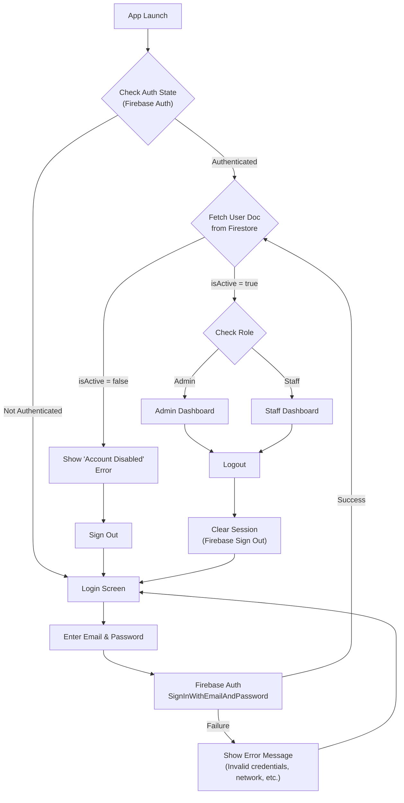

### Authentication Rules

| Scenario | Behavior |
|----------|----------|
| Valid credentials, active user | Navigate to role-based Dashboard |
| Valid credentials, inactive user | Show error, sign out immediately |
| Invalid credentials | Show error on Login Screen |
| Token expired (mid-session) | Redirect to Login Screen |
| No network at login | Show network error |

---

## 3. Order Creation Flow

This is the **most critical workflow** in the application. It involves selecting products, setting sweet levels and quantities, and snapshotting prices at order time.

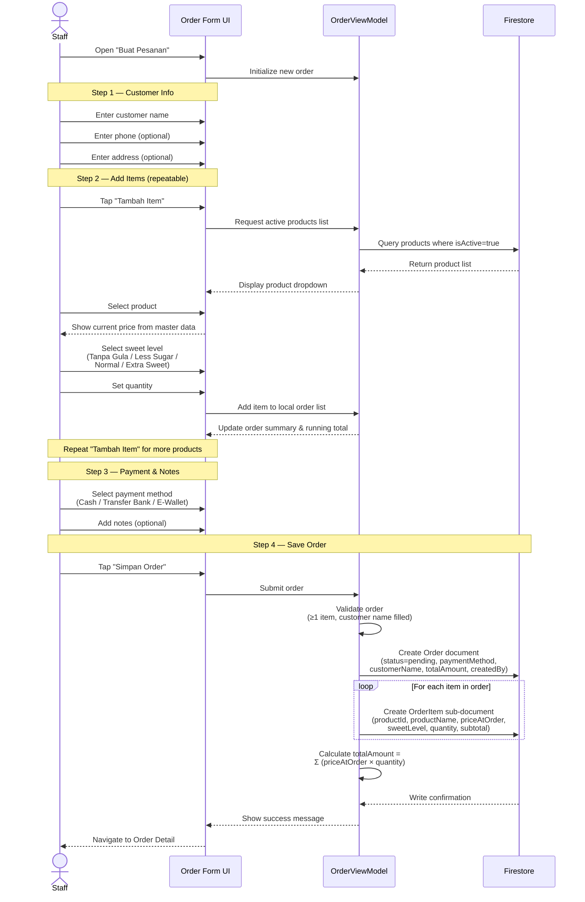

### Price Snapshot Detail

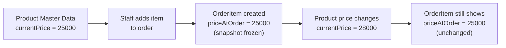

### Order Data Structure at Save

| Field | Source | Example |
|-------|--------|---------|
| `customerName` | User input | "Bu Sari" |
| `customerPhone` | User input (optional) | "081234567890" |
| `customerAddress` | User input (optional) | "Jl. Merdeka No. 10" |
| `paymentMethod` | User selection | "cash" |
| `status` | Auto-set | "pending" |
| `totalAmount` | Calculated | 75000 |
| `notes` | User input (optional) | "Antar sore" |
| `createdBy` | Auth state | "userId123" |
| `createdAt` | Server timestamp | — |
| **items/** `productName` | Snapshot from product | "Susu Kedelai Original" |
| **items/** `priceAtOrder` | Snapshot from product | 25000 |
| **items/** `sweetLevel` | User selection | "normal" |
| **items/** `quantity` | User input | 3 |
| **items/** `subtotal` | priceAtOrder × quantity | 75000 |

---

## 4. Order Status Update Flow

Orders follow a strict state machine. Certain transitions are role-restricted.

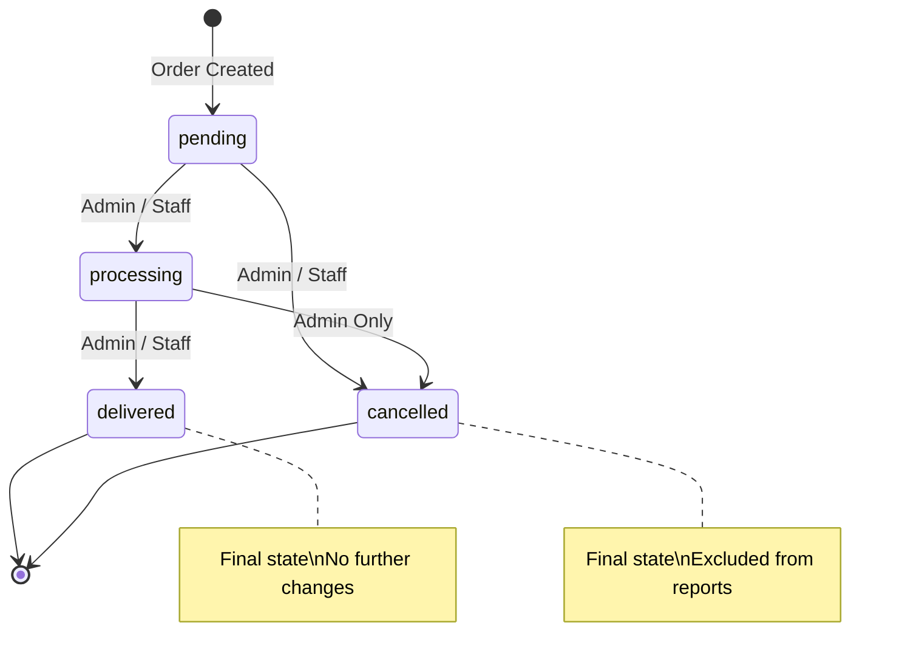

### Transition Permissions

| From | To | Admin | Staff |
|------|----|:-----:|:-----:|
| pending | processing | ✅ | ✅ |
| pending | cancelled | ✅ | ✅ |
| processing | delivered | ✅ | ✅ |
| processing | cancelled | ✅ | ❌ |

### Status Update Sequence

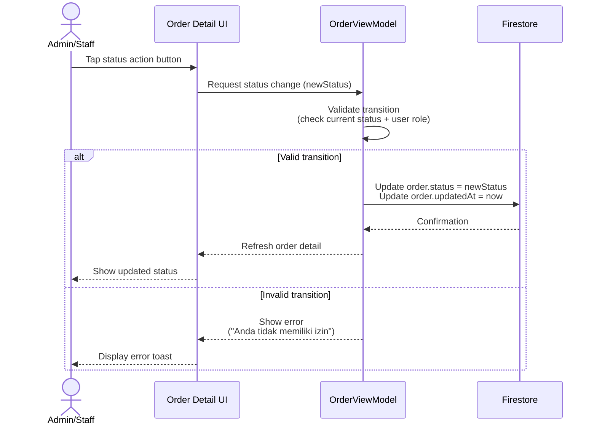

---

## 5. Product Management Flow (Admin Only)

### 5.1 Add Product

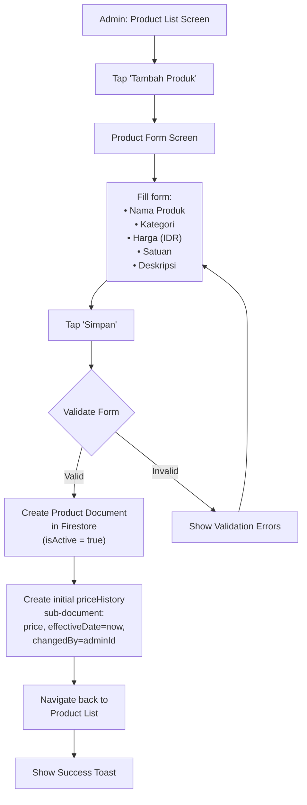

### 5.2 Edit Product (with Price Change)

When an admin edits a product, the system checks whether the price has changed. If so, it automatically creates a new `priceHistory` entry — all within a single Firestore transaction.

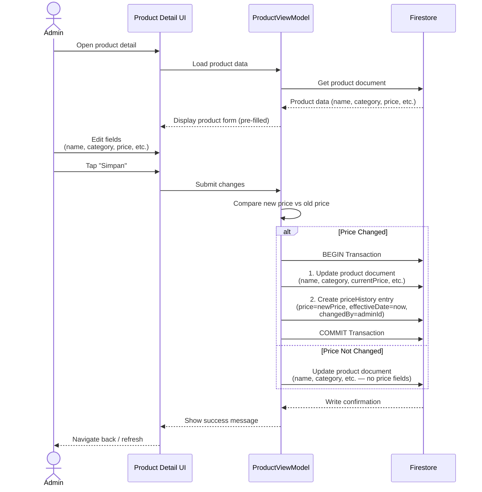

### 5.3 Deactivate Product

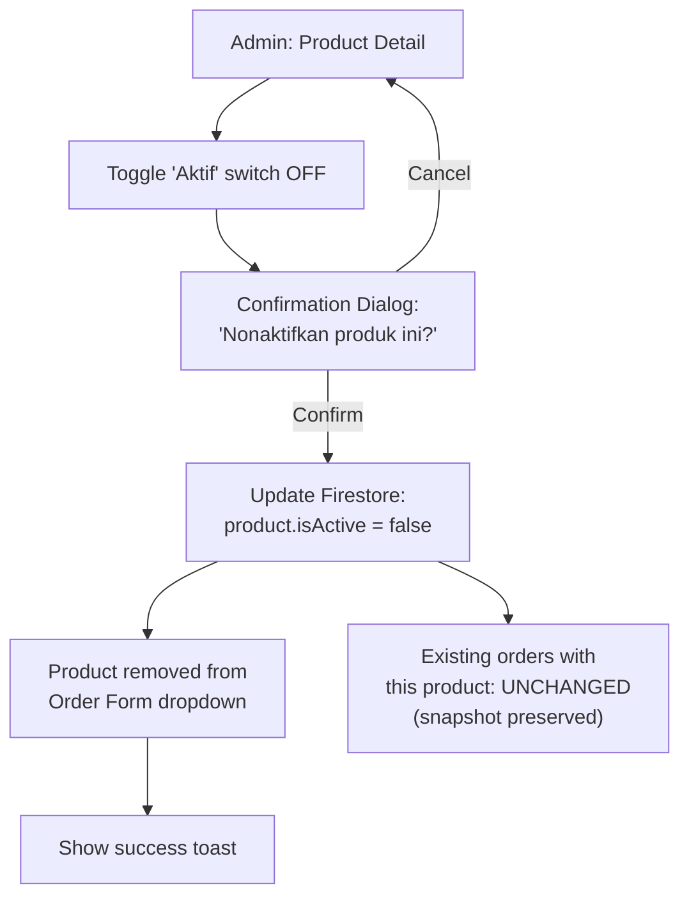

> [!IMPORTANT]
> Deactivating a product only hides it from the order creation form. All existing orders that reference this product retain their snapshot data (`productName`, `priceAtOrder`) and are completely unaffected.

---

## 6. Report Generation Flow

Reports aggregate order data using the **already-snapshotted prices** in each order — no need to look up historical product prices.

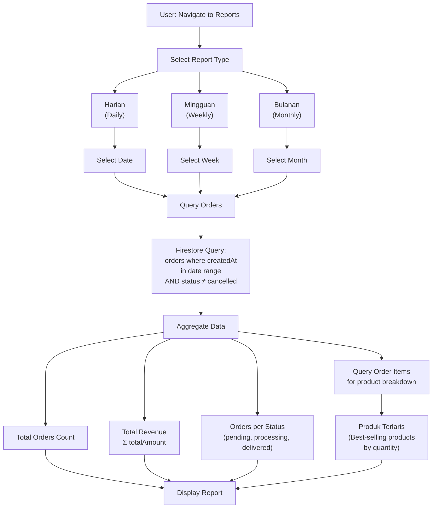

### Report Data Aggregation

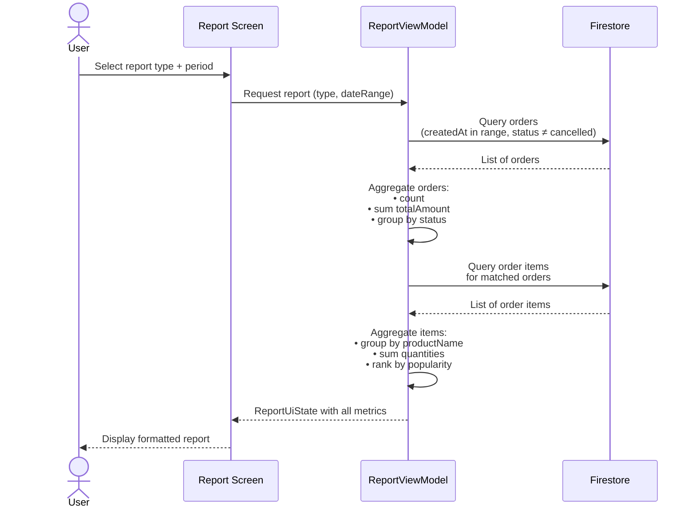

### Report Metrics Summary

| Metric | Calculation | Source |
|--------|-------------|--------|
| Total Pesanan | `COUNT(orders)` | orders collection |
| Total Pendapatan | `SUM(order.totalAmount)` | orders collection |
| Pesanan per Status | `GROUP BY status` | orders collection |
| Produk Terlaris | `GROUP BY productName, SUM(quantity), ORDER BY DESC` | order items sub-collection |

---

## 7. User Management Flow (Admin Only)

### 7.1 Add User

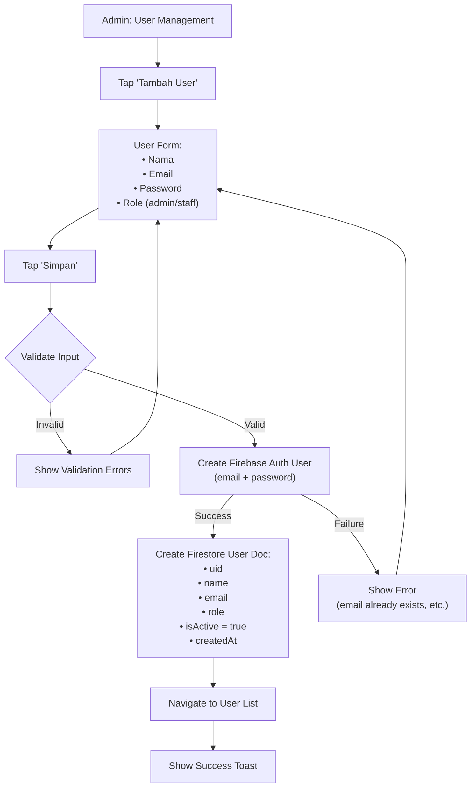

### 7.2 Deactivate User

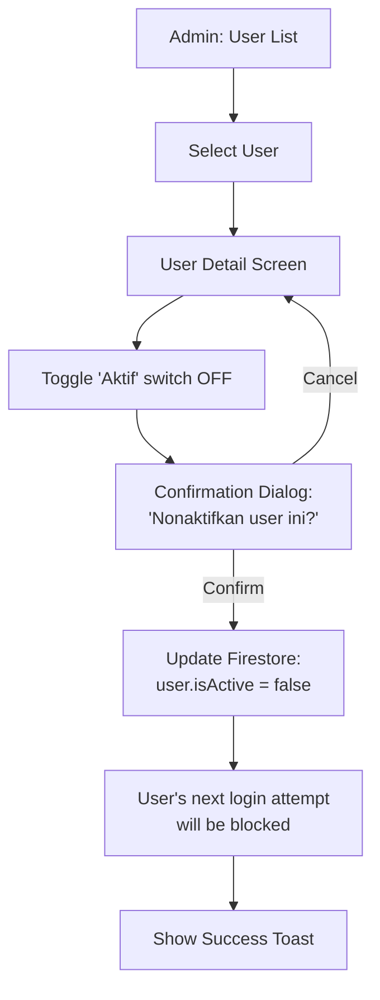

> [!NOTE]
> Deactivating a user sets `isActive = false` in the Firestore user document. The Firebase Auth account still exists, but the app checks `isActive` during the authentication flow (see [Section 2](#2-authentication-flow)) and blocks login for inactive users.

---

## 8. Data Sync Flow

JoyMilk uses **Firestore real-time listeners** to keep all connected devices in sync. Firestore also provides built-in offline persistence for handling intermittent connectivity.

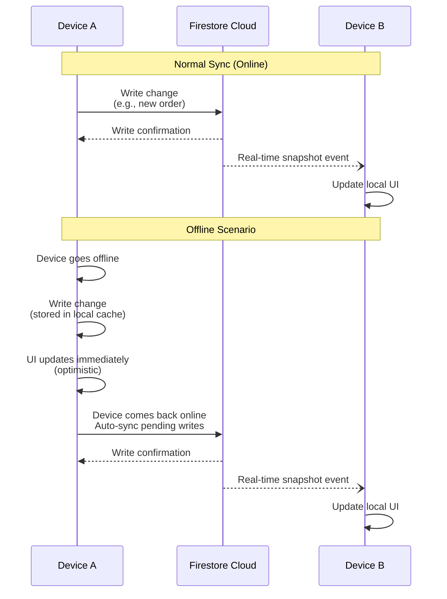

### Sync Behavior Summary

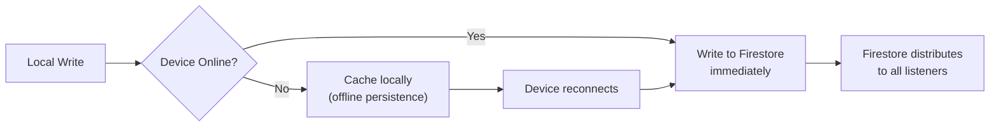

| Scenario | Behavior |
|----------|----------|
| Both devices online | Real-time sync within ~1–2 seconds |
| Writer device offline | Changes cached locally, synced on reconnect |
| Reader device offline | Reads from local cache, receives updates on reconnect |
| Concurrent edits | Firestore last-write-wins (see [Section 9](#9-error-handling-flows)) |

---

## 9. Error Handling Flows

### 9.1 Network Error During Order Save

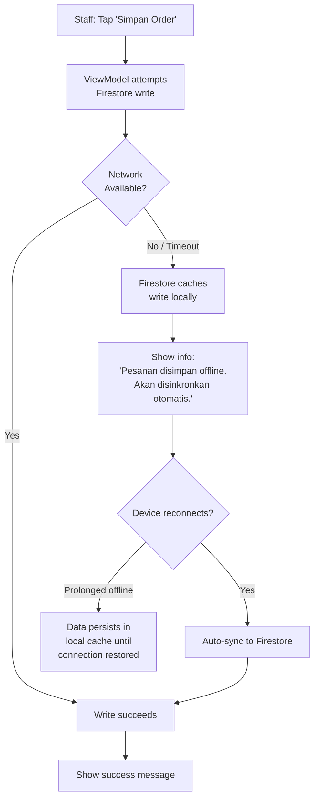

### 9.2 Authentication Expired

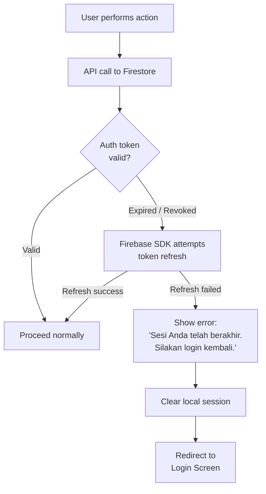

### 9.3 Concurrent Edit Conflict

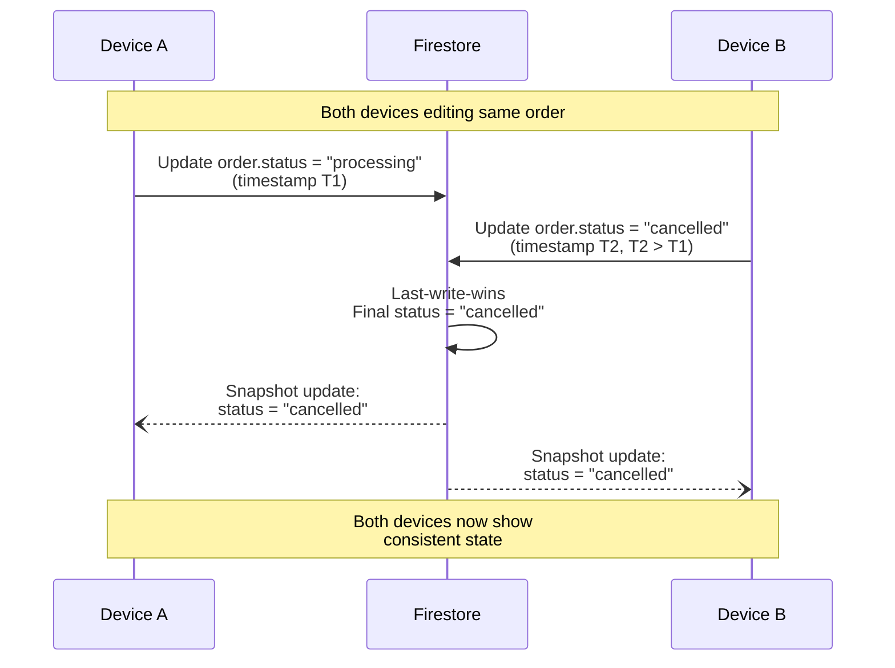

> [!WARNING]
> Firestore uses a **last-write-wins** strategy for concurrent edits. For the JoyMilk app (2–5 internal users), this is an acceptable trade-off. If stricter conflict resolution is needed in the future, Firestore Transactions can enforce optimistic concurrency control.

### Error Handling Summary

| Error Type | User-Facing Message | System Behavior |
|------------|---------------------|-----------------|
| Network error (write) | "Pesanan disimpan offline" | Firestore caches locally, auto-syncs |
| Network error (read) | "Tidak dapat memuat data" | Show cached data if available |
| Auth token expired | "Sesi berakhir, silakan login kembali" | Redirect to Login |
| Invalid form input | Field-specific validation messages | Prevent submission |
| Firestore permission denied | "Anda tidak memiliki izin" | Log error, show toast |
| Concurrent edit conflict | No explicit message | Last-write-wins, real-time sync resolves |

---

## 10. Workflow Summary Matrix

| Workflow | Primary Actor | Trigger | Key Firestore Operations |
|----------|---------------|---------|--------------------------|
| Authentication | All | App launch / Login | Read `users` doc |
| Order Creation | Staff / Admin | "Buat Pesanan" | Write `orders` + `items` sub-collection |
| Order Status Update | Staff / Admin | Status button tap | Update `orders` doc |
| Add Product | Admin | "Tambah Produk" | Write `products` + `priceHistory` |
| Edit Product | Admin | Product detail edit | Update `products`, conditionally write `priceHistory` |
| Deactivate Product | Admin | Toggle switch | Update `products.isActive` |
| Report Generation | All | Reports screen | Query `orders` + `items` |
| Add User | Admin | "Tambah User" | Firebase Auth + write `users` doc |
| Deactivate User | Admin | Toggle switch | Update `users.isActive` |
| Data Sync | System | Automatic | Real-time listeners + offline cache |
